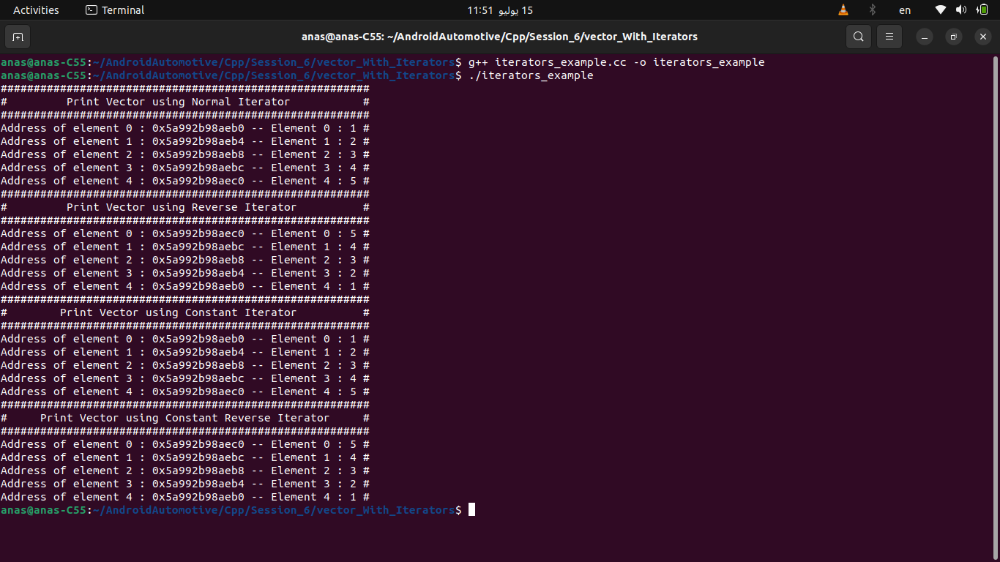
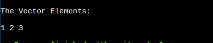
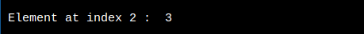

# ModernCpp — C++ STL Complete Guide

A practical, example-driven reference for the C++ Standard Template Library (STL) containers: how to construct them, how to use every major method, and — for `vector` specifically — a full set of classic problem-solving patterns (two pointers, sliding window, prefix sums, etc.).

> Compiler flags assumed: C++17/20 (`-std=c++20`). Features marked `(C++11)`, `(C++17)`, `(C++20)`, `(C++23)`, `(C++26)` require that standard or newer.

## Table of Contents

- [1. STL (Standard Template Library) in C++](#1-stl-standard-template-library-in-c)
   - [1.1 🛠 Components of STL](#11--components-of-stl)
   - [1.2 1️⃣ STL Containers (Data Structures)](#12-1-stl-containers-data-structures)
   - [1.3 2️⃣ STL Algorithms (Operations on Containers)](#13-2-stl-algorithms-operations-on-containers)
   - [1.4 3️⃣ STL Iterators (Traversal Mechanism)](#14-3-stl-iterators-traversal-mechanism)
   - [1.5 4️⃣ Function Objects (Functors)](#15-4-function-objects-functors)
   - [1.6 🚀 Why Use STL?](#16--why-use-stl)
   - [1.7 🎯 Summary](#17--summary)
- [2. Range-Based For Loops](#2-range-based-for-loops)
   - [2.1 Basic Syntax](#21-basic-syntax)
   - [2.2 Example with a Standard Library Container](#22-example-with-a-standard-library-container)
   - [2.3 Using References](#23-using-references)
   - [2.4 Using `const` References](#24-using-const-references)
   - [2.5 Range-Based `for` Loop with Arrays](#25-range-based-for-loop-with-arrays)
   - [2.6 Range-Based `for` Loop with Initializer Lists](#26-range-based-for-loop-with-initializer-lists)
   - [2.7 Custom Iterators](#27-custom-iterators)
   - [2.8 Summary](#28-summary)
- [3. Iterators in Depth](#3-iterators-in-depth)
   - [3.1 General Syntax](#31-general-syntax)
   - [3.2 Iterator Types in the Context of Vectors](#32-iterator-types-in-the-context-of-vectors)
   - [3.3 `begin()` vs `cbegin()`](#33-begin-vs-cbegin)
   - [3.4 Basic Iterator Operations](#34-basic-iterator-operations)
   - [3.5 Debugging Iterators with `-D_GLIBCXX_DEBUG`](#35-debugging-iterators-with--d_glibcxx_debug)
   - [3.6 Full Example: Printing a Vector with All Four Iterator Kinds](#36-full-example-printing-a-vector-with-all-four-iterator-kinds)
- [4. std::array](#4-stdarray)
   - [4.1 Why Does std::array Exist?](#41-why-does-stdarray-exist)
   - [4.2 Overview](#42-overview)
   - [4.3 Initialization & Quick Tour (C++11)](#43-initialization--quick-tour-c11)
   - [4.4 Member Functions](#44-member-functions)
- [5. std::vector](#5-stdvector)
   - [5.1 Initialization](#51-initialization)
   - [5.2 Member Functions by Category](#52-member-functions-by-category)
   - [5.3 Algorithms Commonly Used with vector](#53-algorithms-commonly-used-with-vector)
   - [5.4 std::array vs std::vector](#54-stdarray-vs-stdvector)
- [6. vector — Problem-Solving Patterns](#6-vector--problem-solving-patterns)
   - [6.1 Two Pointers](#61-two-pointers)
   - [6.2 Sliding Window](#62-sliding-window)
   - [6.3 Prefix Sums](#63-prefix-sums)
   - [6.4 Kadane's Algorithm (Max Subarray)](#64-kadanes-algorithm-max-subarray)
   - [6.5 Binary Search on a Sorted Vector](#65-binary-search-on-a-sorted-vector)
   - [6.6 Sorting + Custom Comparators](#66-sorting--custom-comparators)
   - [6.7 Dutch National Flag / Partitioning](#67-dutch-national-flag--partitioning)
   - [6.8 Merge Intervals](#68-merge-intervals)
   - [6.9 Fast & Slow Pointers](#69-fast--slow-pointers)
   - [6.10 Binary Search on the Answer](#610-binary-search-on-the-answer)
- [7. Other Sequence Containers](#7-other-sequence-containers)
   - [7.1 `deque`](#71-deque)
   - [7.2 `list`](#72-list)
   - [7.3 `forward_list` (C++11)](#73-forward_list-c11)
- [8. Associative Containers](#8-associative-containers)
   - [8.1 `set`](#81-set)
   - [8.2 `multiset`](#82-multiset)
   - [8.3 `map`](#83-map)
   - [8.4 `multimap`](#84-multimap)
- [9. Unordered Associative Containers](#9-unordered-associative-containers)
   - [9.1 `unordered_set` (C++11)](#91-unordered_set-c11)
   - [9.2 `unordered_multiset` (C++11)](#92-unordered_multiset-c11)
   - [9.3 `unordered_map` (C++11)](#93-unordered_map-c11)
   - [9.4 `unordered_multimap` (C++11)](#94-unordered_multimap-c11)
- [10. Container Adaptors](#10-container-adaptors)
   - [10.1 `stack`](#101-stack)
   - [10.2 `queue`](#102-queue)
   - [10.3 `priority_queue`](#103-priority_queue)
- [11. Views](#11-views)
   - [11.1 `span` (C++20)](#111-span-c20)
   - [11.2 `mdspan` (C++23)](#112-mdspan-c23)
- [12. Implementing My Own Vector Class](#12-implementing-my-own-vector-class)
- [13. Quick Reference: Which Container to Use?](#13-quick-reference-which-container-to-use)
- [14. References](#14-references)

---

## 1. STL (Standard Template Library) in C++

The **Standard Template Library (STL)** is a powerful library in C++ that provides **generic and reusable components** such as containers, algorithms, iterators, and functions. It enables efficient programming by offering **ready-made data structures** and **algorithms**.

### 1.1 🛠 Components of STL

STL is divided into **four main components:**

| Component | Description | Purpose |
| --- | --- | --- |
| **1️⃣ Containers** | Predefined data structures like vectors, lists, maps, and sets | Store collections of objects (`vector`, `map`, `set`, ...) |
| **2️⃣ Algorithms** | Functions for sorting, searching, and modifying data | Generic functions (`sort`, `find`, `accumulate`, ...) that operate via iterators |
| **3️⃣ Iterators** | Objects that allow traversal through containers | Generalized pointers that traverse containers |
| **4️⃣ Function Objects (Functors) / Lambdas** | Special functions that behave like objects | Customize algorithm/container behavior (comparators, predicates) |

### 1.2 1️⃣ STL Containers (Data Structures)

Containers are **pre-built data structures** used to store and manage data.

| Type                       | Containers                                                   | Description                       |
| -------------------------- | ------------------------------------------------------------ | --------------------------------- |
| **Sequence Containers**    | `vector`, `array`, `list`, `deque`, `forward_list`           | Store elements in a linear order  |
| **Associative Containers** | `set`, `map`, `unordered_set`, `unordered_map`, `multiset`, `multimap` | Store key-value pairs efficiently |
| **Container Adapters**     | `stack`, `queue`, `priority_queue`                           | Restrict/modify container behavior |

In more detail, containers split into:

- **Sequence containers** — ordered by insertion/position: `vector`, `array`, `deque`, `list`, `forward_list`
- **Associative containers** — ordered by key (usually a balanced tree): `set`, `multiset`, `map`, `multimap`
- **Unordered associative containers** — hash-table based: `unordered_set`, `unordered_multiset`, `unordered_map`, `unordered_multimap`
- **Container adaptors** — restricted interfaces built on top of other containers: `stack`, `queue`, `priority_queue`
- **Views** (not owning containers) — `span`, `mdspan`

Common headers you'll need: `<vector>`, `<array>`, `<deque>`, `<list>`, `<forward_list>`, `<set>`, `<map>`, `<unordered_set>`, `<unordered_map>`, `<stack>`, `<queue>`, `<span>`, `<mdspan>`, `<algorithm>`, `<numeric>`.

✔ **Example - Using `vector`:**

```c++
#include <iostream>
#include <vector>

int main() {
    std::vector<int> v = {1, 2, 3}; 
    v.push_back(4); // Add element

    for (int num : v)
        std::cout << num << " "; // Output: 1 2 3 4
}
```

### 1.3 2️⃣ STL Algorithms (Operations on Containers)

STL provides **predefined algorithms** for **sorting, searching, modifying**, etc.

✔ **Example - Sorting and Finding Elements:**

```c++
#include <iostream>
#include <vector>
#include <algorithm>

int main() {
    std::vector<int> v = {3, 1, 4, 2};

    std::sort(v.begin(), v.end()); // Sort elements
    std::cout << "Sorted: ";
    for (int num : v) std::cout << num << " "; // Output: 1 2 3 4

    if (std::binary_search(v.begin(), v.end(), 3)) 
        std::cout << "\nFound 3!";
}
```

📌 **Popular Algorithms in STL:**

| Algorithm                  | Description              |
| -------------------------- | ------------------------ |
| `sort(begin, end)`         | Sort elements            |
| `reverse(begin, end)`      | Reverse a range          |
| `find(begin, end, value)`  | Search for a value       |
| `count(begin, end, value)` | Count occurrences        |
| `min_element(begin, end)`  | Find the minimum element |
| `max_element(begin, end)`  | Find the maximum element |

### 1.4 3️⃣ STL Iterators (Traversal Mechanism)

Iterators are **pointers** that allow **sequential access** to elements in containers.

✔ **Example - Using Iterators:**

```c++
#include <iostream>
#include <vector>

int main() {
    std::vector<int> v = {10, 20, 30};
    
    std::vector<int>::iterator it; // Declare iterator
    for (it = v.begin(); it != v.end(); ++it)
        std::cout << *it << " "; // Output: 10 20 30
}
```

📌 **Types of Iterators:**

| Iterator Type              | Description                  | Example Containers         |
| -------------------------- | ---------------------------- | -------------------------- |
| **Input Iterator**         | Read elements **once**       | `istream_iterator`         |
| **Output Iterator**        | Write elements **once**      | `ostream_iterator`         |
| **Forward Iterator**       | Traverse forward             | `forward_list`             |
| **Bidirectional Iterator** | Traverse forward & backward  | `list`, `set`, `map`       |
| **Random Access Iterator** | Access elements **randomly** | `vector`, `deque`, `array` |

> For the full treatment of iterators see [§3 Iterators in Depth](#3-iterators-in-depth).

### 1.5 4️⃣ Function Objects (Functors)

A **functor** is a class with an overloaded `operator()`, making it behave like a function.

✔ **Example - Using a Functor:**

```c++
#include <iostream>
#include <algorithm>
#include <vector>

struct MultiplyByTwo {
    void operator()(int &n) { n *= 2; }
};

int main() {
    std::vector<int> v = {1, 2, 3};
    std::for_each(v.begin(), v.end(), MultiplyByTwo()); 

    for (int num : v) std::cout << num << " "; // Output: 2 4 6
}
```

📌 **Uses of Functors:**

- Custom sorting
- Modifying elements
- Predicate functions (used with `remove_if`, `find_if`, etc.)

### 1.6 🚀 Why Use STL?

✅ **Saves Time** – No need to implement common data structures manually.
✅ **Efficient & Optimized** – STL is well-tested for performance.
✅ **Portable & Reusable** – Works across different platforms.
✅ **Generic & Flexible** – Uses templates to work with any data type.

### 1.7 🎯 Summary

| STL Component  | Purpose             | Example                                         |
| -------------- | ------------------- | ----------------------------------------------- |
| **Containers** | Store elements      | `vector<int> v = {1, 2, 3};`                    |
| **Algorithms** | Process elements    | `std::sort(v.begin(), v.end());`                |
| **Iterators**  | Traverse containers | `std::vector<int>::iterator it = v.begin();`    |
| **Functors**   | Act like functions  | `struct Multiply { void operator()(int &n); };` |

---

## 2. Range-Based For Loops

The range-based `for` loop, introduced in C++11, provides a more concise and readable way to iterate over elements in a container (like arrays, vectors, lists, etc.) or any range-supporting object. It simplifies the syntax compared to the traditional `for` loop and reduces the potential for errors.

### 2.1 Basic Syntax

The range-based `for` loop has the following syntax:

```c++
for (declaration : range) {
    // loop body
}
```

- **`declaration`**: This is the type and variable name that will take on the value of each element in the range during each iteration.
- **`range`**: This is the container or range to iterate over.

### 2.2 Example with a Standard Library Container

Here is an example using a `std::vector`:

```c++
#include <iostream>
#include <vector>

int main() {
    std::vector<int> numbers = {1, 2, 3, 4, 5};

    // Range-based for loop
    for (int num : numbers) {
        std::cout << num << " ";
    }
    std::cout << std::endl;

    return 0;
}
```

>When you use a range-based for loop without a reference (`int num` instead of `int& num`), the loop variable (`num`) **receives a copy** of each element in the container. This means any modifications made inside the loop affect **only the copy**, not the original container.

### 2.3 Using References

If you need to modify the elements of the container, you should use a reference in the declaration:

```c++
#include <iostream>
#include <vector>

int main() {
    std::vector<int> numbers = {1, 2, 3, 4, 5};

    // Modify elements using a reference
    for (int& num : numbers) {
        num *= 2;
    }

    for (int num : numbers) {
        std::cout << num << " ";
    }
    std::cout << std::endl;

    return 0;
}
```

### 2.4 Using `const` References

If you are not modifying the elements and want to avoid copying them, you can use `const` references (the standard choice for read-only loops over non-trivial types):

```c++
#include <iostream>
#include <vector>

int main() {
    std::vector<int> numbers = {1, 2, 3, 4, 5};

    // Use const reference to avoid copying elements
    for (const int& num : numbers) {
        std::cout << num << " ";
    }
    std::cout << std::endl;

    return 0;
}
```

### 2.5 Range-Based `for` Loop with Arrays

The range-based `for` loop also works with arrays:

```c++
#include <iostream>

int main() {
    int arr[] = {1, 2, 3, 4, 5};

    for (int num : arr) {
        std::cout << num << " ";
    }
    std::cout << std::endl;

    return 0;
}
```

### 2.6 Range-Based `for` Loop with Initializer Lists

You can also use range-based `for` loops with initializer lists:

```c++
#include <iostream>

int main() {
    for (int num : {1, 2, 3, 4, 5}) {
        std::cout << num << " ";
    }
    std::cout << std::endl;

    return 0;
}
```

### 2.7 Custom Iterators

Range-based `for` loops work with any class that has `begin()` and `end()` member functions returning iterators, which includes all standard library containers. See [§12 Implementing My Own Vector Class](#12-implementing-my-own-vector-class) — returning raw `T*` pointers from `begin()`/`end()` is already enough.

### 2.8 Summary

The range-based `for` loop simplifies iterating over elements in a container, improving code readability and reducing the potential for errors. Here’s a summary example combining various use cases:

```c++
#include <iostream>
#include <vector>
#include <list>
#include <string>

int main() {
    std::vector<int> vec = {1, 2, 3, 4, 5};
    std::list<std::string> strList = {"Hello", "World", "C++"};
    int arr[] = {10, 20, 30, 40, 50};

    // Vector
    for (int num : vec) {
        std::cout << num << " ";
    }
    std::cout << std::endl;

    // List with const reference
    for (const std::string& str : strList) {
        std::cout << str << " ";
    }
    std::cout << std::endl;

    // Array
    for (int num : arr) {
        std::cout << num << " ";
    }
    std::cout << std::endl;

    // Initializer list
    for (int num : {100, 200, 300}) {
        std::cout << num << " ";
    }
    std::cout << std::endl;

    return 0;
}
```

---

## 3. Iterators in Depth

In C++, an iterator is an object that allows you to traverse through the elements of a container, such as a vector. Iterators are similar to pointers in that they can be incremented and dereferenced to access the elements of the container they point to. However, iterators are more flexible and safer to use than raw pointers because they encapsulate the underlying mechanism of accessing elements in a container.

### 3.1 General Syntax

```c++
container_type::iterator_type iterator_name = container.begin();
```

Let's break down each part of the general syntax:

1. **`container_type`**: The type of the container (e.g., `std::vector<int>`).
2. **`iterator_type`**: The specific type of iterator (`iterator`, `const_iterator`, `reverse_iterator`, `const_reverse_iterator`).
3. **`iterator_name`**: The name you give to the iterator variable (e.g., `it`).
4. **`container.begin()`**: The function that returns the starting point for the iterator.

Let's look at each specific example you mentioned and explain it within this general syntax:

**For example :**

```c++
std::vector<int>::iterator it = vec.begin();
```

- **`std::vector<int>`**: The type of the container.
- **`iterator`**: The type of the iterator that can read/write elements.
- **`it`**: The name of the iterator variable.
- **`vec.begin()`**: Returns an iterator pointing to the first element of `vec`.

### 3.2 Iterator Types in the Context of Vectors

Here are the types of iterators commonly used with `std::vector` in C++:

1. **Random Access Iterator**: Iterators provided by `std::vector` are random access iterators. This means they support a full range of operations like pointer arithmetic, including addition and subtraction, as well as comparison operations.

2. **Vector Iterators**:

   - **`begin()`**: Returns an iterator pointing to the first element of the vector.

   - **`end()`**: Returns an iterator pointing to **one past** the last element of the vector.

     >- **`end()`**: Returns an iterator that is **one past** the last element of the vector. This position is not valid for dereferencing; it’s used primarily to mark the end of the sequence.
     >
     >- For example, if you have a vector of 5 elements, `end()` points to a position that is after the last (6th) position, which is not accessible for reading or writing.

   - **`rbegin()`**: Returns a reverse iterator pointing to the last element of the vector (reverse traversal).

   - **`rend()`**: Returns a reverse iterator pointing to one before the first element of the vector (reverse traversal).

     >**`rend()`** points to the position just before the first element of the vector when traversing in reverse. It is **not dereferenceable** and serves as a boundary marker for reverse iteration.

   - **`cbegin()`**: Returns a constant iterator pointing to the first element of the vector.

   - **`cend()`**: Returns a constant iterator pointing to **one past** the last element of the vector.

   - **`crbegin()`**: Returns a constant reverse iterator pointing to the last element of the vector.

   - **`crend()`**: Returns a constant reverse iterator pointing to **one before** the first element of the vector.

#### Types of Iterators and Their Differences

1. **`begin()` vs. `cbegin()`**
   - **`begin()`**: Returns a non-const iterator that allows you to modify the elements of the vector.
   - **`cbegin()`**: Returns a constant iterator that **does not allow you to modify** the elements of the vector. It is read-only.
2. **`end()` vs. `cend()`**
   - **`end()`**: Returns a non-const iterator that points to one past the last element of the vector.
   - **`cend()`**: Returns a constant iterator that also points to one past the last element, but does not allow modification of the vector’s elements.
3. **`rbegin()` vs. `crbegin()`**
   - **`rbegin()`**: Returns a reverse iterator that allows you to traverse the vector in reverse and modify the elements.
   - **`crbegin()`**: Returns a constant reverse iterator that allows reverse traversal but does not allow modification of the vector’s elements.
4. **`rend()` vs. `crend()`**
   - **`rend()`**: Returns a reverse iterator that points to one before the first element of the vector, allowing you to traverse backwards and modify elements.
   - **`crend()`**: Returns a constant reverse iterator that points to one before the first element in reverse traversal, but you cannot modify the elements.

- **Non-const Iterators (`begin()`, `end()`, `rbegin()`, `rend()`)**: These iterators allow you to both read from and write to the elements of the vector.
- **Constant Iterators (`cbegin()`, `cend()`, `crbegin()`, `crend()`)**: These iterators only allow you to read from the elements; you cannot modify them.

Here’s a more detailed look at how constant iterators affect your code:

```c++
#include <vector>
#include <iostream>

int main() {
    std::vector<int> v = {1, 2, 3, 4, 5};

    // Non-const iterators
    for (auto it = v.begin(); it != v.end(); ++it) {
        *it = 10;  // Modifying elements
    }

    // Const iterators
    for (auto it = v.cbegin(); it != v.cend(); ++it) {
        // *it = 10;  // Error: Cannot modify elements
        std::cout << *it << " ";  // Reading elements
    }
    std::cout << std::endl;

    // Non-const reverse iterators
    for (auto rit = v.rbegin(); rit != v.rend(); ++rit) {
        *rit = 20;  // Modifying elements
    }

    // Const reverse iterators
    for (auto rit = v.crbegin(); rit != v.crend(); ++rit) {
        // *rit = 20;  // Error: Cannot modify elements
        std::cout << *rit << " ";  // Reading elements
    }
    std::cout << std::endl;

    return 0;
}
```

| Iterator    | Type      | Can Modify Elements?      |
| ----------- | --------- | ------------------------- |
| `begin()`   | Non-const | Yes                       |
| `end()`     | Non-const | N/A (points past end)     |
| `rbegin()`  | Non-const | Yes                       |
| `rend()`    | Non-const | N/A (points before begin) |
| `cbegin()`  | Constant  | No                        |
| `cend()`    | Constant  | N/A (points past end)     |
| `crbegin()` | Constant  | No                        |
| `crend()`   | Constant  | N/A (points before begin) |

#### Example of Usage

```c++
#include <vector>
#include <iostream>

int main() {
    std::vector<int> v = {1, 2, 3, 4, 5};

    // Using non-const iterator
    for (auto it = v.begin(); it != v.end(); ++it) {
        *it = 10;  // Allowed: modifying elements
    }

    // Using constant iterator
    for (auto it = v.cbegin(); it != v.cend(); ++it) {
        std::cout << *it << " ";  // Allowed: reading elements
        // *it = 20;  // Error: cannot modify elements
    }
    std::cout << std::endl;

    // Using non-const reverse iterator
    for (auto rit = v.rbegin(); rit != v.rend(); ++rit) {
        *rit = 20;  // Allowed: modifying elements
    }

    // Using constant reverse iterator
    for (auto rit = v.crbegin(); rit != v.crend(); ++rit) {
        std::cout << *rit << " ";  // Allowed: reading elements
        // *rit = 30;  // Error: cannot modify elements
    }
    std::cout << std::endl;

    return 0;
}
```

### 3.3 `begin()` vs `cbegin()`

**Difference Between `cbegin()` and `begin()` in C++ STL** :

Both `begin()` and `cbegin()` are **member functions** used to get an iterator to the first element of a container, but they have a key difference:

| Function       | Return Type      | Mutability                               |
| -------------- | ---------------- | ---------------------------------------- |
| **`begin()`**  | `iterator`       | ✅ **Allows modification**                |
| **`cbegin()`** | `const_iterator` | ❌ **Read-only (cannot modify elements)** |

#### 📌 `begin()` - Returns a Mutable Iterator

- Allows **modifying** the elements of the container.
- Returns an **iterator** of type `std::array<int, 5>::iterator`.

✔ **Example: Using `begin()` to Modify Elements**

```c++
#include <iostream>
#include <array>

int main() {
   std::array<int, 5> arr = {1, 2, 3, 4, 5};

   for (auto it = arr.begin(); it != arr.end(); ++it) {
       *it *= 2;  // ✅ Allowed (modifies elements)
   }

   for (int num : arr) {
       std::cout << num << ' ';  // Output: 2 4 6 8 10
   }
}
```

#### 📌 `cbegin()` - Returns a Constant Iterator

- **Prevents modification** of elements.
- Returns an **iterator** of type `std::array<int, 5>::const_iterator`.
- Useful when you want to ensure **read-only access** to elements.

✔ **Example: Using `cbegin()` (Read-Only)**

```c++
#include <iostream>
#include <array>

int main() {
   std::array<int, 5> arr = {1, 2, 3, 4, 5};

   for (auto it = arr.cbegin(); it != arr.cend(); ++it) {
       std::cout << *it << ' ';  // ✅ Allowed (only reading)
       // *it *= 2; ❌ ERROR: Cannot modify read-only elements
   }
}
```

🔹 Output: `1 2 3 4 5`

#### 🛠 When to Use `cbegin()` vs `begin()`?

| Use Case                                   | Which One to Use? |
| ------------------------------------------ | ----------------- |
| Need to modify elements                    | ✅ Use `begin()`   |
| Only need to read elements (ensure safety) | ✅ Use `cbegin()`  |

### 3.4 Basic Iterator Operations

- **Dereferenceable**: You can use the `*` operator to access the element pointed to by the iterator.
- **Incrementable**: You can use the `++` operator to move the iterator to the next element.
- **Decrementable**: You can use the `--` operator to move the iterator to the previous element.
- **Add/Subtract**: You can add or subtract an integer to/from the iterator (e.g., `it + 5` to move 5 positions forward).
- **Difference**: You can find the distance between two iterators (e.g., `it2 - it1` to find the number of elements between `it1` and `it2`).
- **Comparison**: You can use relational operators (`<`, `>`, `<=`, `>=`, `==`, `!=`) to compare iterators.

Here's an extended example demonstrating random access operations on a `std::vector` using iterators:

```c++
#include <iostream>
#include <vector>

int main() {
    std::vector<int> vec = {1, 2, 3, 4, 5};

    // Using iterator to access elements
    std::vector<int>::iterator it = vec.begin();
    std::cout << "First element: " << *it << std::endl;

    // Increment iterator
    ++it;
    std::cout << "Second element: " << *it << std::endl;

    // Decrement iterator
    --it;
    std::cout << "Back to first element: " << *it << std::endl;

    // Random access
    it += 3;
    std::cout << "Fourth element: " << *it << std::endl;

    it -= 2;
    std::cout << "Second element again: " << *it << std::endl;

    // Difference between iterators
    std::vector<int>::iterator it2 = vec.end();
    std::cout << "Distance from begin to end: " << it2 - vec.begin() << std::endl;

    // Comparison of iterators
    if (it < it2) {
        std::cout << "Iterator it is before iterator it2" << std::endl;
    }

    return 0;
}
```

#### Explanation of the Code:

1. **Dereferencing**:

   ```c++
   std::vector<int>::iterator it = vec.begin();
   std::cout << "First element: " << *it << std::endl;
   ```

   - The iterator `it` is initialized to point to the first element of the vector.
   - `*it` accesses the value of the first element.

2. **Increment**:

   ```c++
   ++it;
   std::cout << "Second element: " << *it << std::endl;
   ```

   - The iterator `it` is incremented to point to the next element.
   - `*it` now accesses the value of the second element.

3. **Decrement**:

   ```c++
   --it;
   std::cout << "Back to first element: " << *it << std::endl;
   ```

   - The iterator `it` is decremented to point back to the first element.
   - `*it` accesses the value of the first element again.

4. **Random Access**:

   ```c++
   it += 3;
   std::cout << "Fourth element: " << *it << std::endl;
   ```

   - The iterator `it` is moved forward by 3 positions.
   - `*it` accesses the value of the fourth element.

   ```c++
   it -= 2;
   std::cout << "Second element again: " << *it << std::endl;
   ```

   - The iterator `it` is moved backward by 2 positions.
   - `*it` accesses the value of the second element.

5. **Difference**:

   ```c++
   std::vector<int>::iterator it2 = vec.end();
   std::cout << "Distance from begin to end: " << it2 - vec.begin() << std::endl;
   ```

   - The iterator `it2` is initialized to point one past the last element of the vector.
   - `it2 - vec.begin()` calculates the number of elements between the beginning and the end of the vector.

6. **Comparison**:

   ```c++
   if (it < it2) {
       std::cout << "Iterator it is before iterator it2" << std::endl;
   }
   ```

   - The comparison `it < it2` checks if `it` is before `it2`.

### 3.5 Debugging Iterators with `-D_GLIBCXX_DEBUG`

#### Example: dereferencing `end()` (undefined behavior)

```c++
#include <iostream>
#include <vector>

int main() {
   std::vector<int> vec = {10, 20, 30};
   std::cout << *vec.end()<<std::endl;  
}
```

```c++
g++ -D_GLIBCXX_DEBUG examples.cc -o app
```

#### `-D_GLIBCXX_DEBUG` in C++ (GCC Debug Mode)

`_GLIBCXX_DEBUG` stands for **"GNU LIBC++ eXtension Debug"**, which is part of the **GNU Standard C++ Library (libstdc++)** used in GCC.

- **`GLIBCXX`** → Refers to **GNU's implementation of the C++ Standard Library** (`libstdc++`).
- **`DEBUG`** → Enables **debugging features** for STL containers and iterators.

`-D_GLIBCXX_DEBUG` is a **preprocessor macro** that enables **extra runtime checks** for **Standard Template Library (STL) containers** when compiling with GCC.

It helps **catch common mistakes** like:

- **Dereferencing invalid iterators**
- **Out-of-bounds access**
- **Modifying containers while iterating**
- **Iterator mismatches (e.g., comparing iterators from different containers)**

#### Example: dereferencing `crend()` (undefined behavior)

```c++
#include <iostream>
#include <vector>

int main() {
   std::vector<int> vec = {10, 20, 30, 40, 50};

   auto rit = vec.crbegin(); // ✅ Points to the last element (50)
   std::cout << "Last element: " << *rit << std::endl; // Output: 50

   auto rend = vec.crend();   // ❌ Points before the first element (out of bounds)
   // std::cout << *rend;     // 🚨 Undefined Behavior! Do NOT dereference rend!

   return 0;
}

```

- Without `_GLIBCXX_DEBUG`, this may still **compile and run**, but it can return **garbage values** or **cause a segmentation fault**.

- **With `_GLIBCXX_DEBUG` enabled**, the debug library detects the issue and **aborts execution** with an error.

### 3.6 Full Example: Printing a Vector with All Four Iterator Kinds

```c++
#include <iostream>
#include <vector>

/* Function prints the vector using normal iterator */
void printUsingIterator(std::vector<int>& v)
{
	std::cout << "########################################################\n";
    std::cout << "#         Print Vector using Normal Iterator           #\n";
	std::cout << "########################################################\n";
    int i = 0;
    for (std::vector<int>::iterator it = v.begin(); it != v.end(); ++it)  // Use ++it instead of it++
    {
        /* print the address of the element and the value */
        std::cout << "Address of element " << i << " : " << static_cast<void*>(&(*it))  // Print address
                  << " -- Element " << i << " : " << *it << " #\n";  // Print value
        i++;
    }
}

/* Function prints the vector using reverse begin rbegin()*/
void printUsingReverseIterator(std::vector<int>&v)
{
	int i=0;
	std::cout << "########################################################\n";
    std::cout << "#         Print Vector using Reverse Iterator          #\n";
	std::cout << "########################################################\n";
    for(auto Reverse_it=v.rbegin();Reverse_it !=v.rend();Reverse_it++)
    {
    	std::cout<<"Address of element " << i << " : " <<static_cast<void*>(&(*Reverse_it))<< " -- Element " << i << " : " << *Reverse_it<<" #\n";
    	i++;
    }
}

/* Function prints the vector using constant begin cbegin()*/
void printUsingConstIterator(std::vector<int>&v)
{         
	int i=0;
	std::cout << "########################################################\n";
    std::cout << "#        Print Vector using Constant Iterator          #\n";
	std::cout << "########################################################\n";
    for(auto Reverse_it=v.cbegin();Reverse_it !=v.cend();Reverse_it++)
    {
    	std::cout<<"Address of element " << i << " : " <<static_cast<const int*>(&(*Reverse_it))<< " -- Element " << i << " : " << *Reverse_it<<" #\n";
    	i++;
    }
}

/* Function prints the vector using constant Reverse Iterator*/
void printUsingConstReverseIterator(std::vector<int>&v)
{         
	int i=0;
	std::cout << "########################################################\n";
    std::cout << "#     Print Vector using Constant Reverse Iterator     #\n";
	std::cout << "########################################################\n";
    for(auto ConstReverse_it=v.crbegin();ConstReverse_it !=v.crend();ConstReverse_it++)
    {
    	std::cout<<"Address of element " << i << " : " <<static_cast<const int*>(&(*ConstReverse_it))<< " -- Element " << i << " : " << *ConstReverse_it<<" #\n";
    	i++;
    }
}

int main()
{
    std::vector<int> vec = {1, 2, 3, 4, 5};
   
    printUsingIterator(vec);
    printUsingReverseIterator(vec);
    printUsingConstIterator(vec);
	printUsingConstReverseIterator(vec);
    return 0;
}

```



#### Detailed Explanation:

##### Includes and Namespace

```c++
#include <iostream>
#include <vector>
```

- **`#include <iostream>`**: Includes the standard input-output stream library for using `std::cout`.
- **`#include <vector>`**: Includes the vector library for using the `std::vector` container.

##### Function `printUsingIterator`

```c++
void printUsingIterator(std::vector<int>& v)
{
	std::cout << "########################################################\n";
    std::cout << "#         Print Vector using Normal Iterator           #\n";
	std::cout << "########################################################\n";
    int i = 0;
    for (std::vector<int>::iterator it = v.begin(); it != v.end(); ++it)
    {
        std::cout << "Address of element " << i << " : " << static_cast<void*>(&(*it))
                  << " -- Element " << i << " : " << *it << " #\n";
        i++;
    }
}
```

- **Function Declaration**: Declares a function named `printUsingIterator` which takes a reference to a vector of integers.

- **Printing Header**: Prints a decorative header to the console.

- **Iterator Initialization**: Initializes an iterator `it` to the beginning of the vector `v`.

- **Loop**: Loops from the beginning of the vector to the end using the iterator `it`.

- Print Statement

  : Prints the address and the value of each element:

  - **Address**: `static_cast<void*>(&(*it))` prints the address of the current element.
  - **Value**: `*it` prints the value of the current element.

- **Increment**: Increments the index `i` to track the element's position.

##### Function `printUsingReverseIterator`

```c++
void printUsingReverseIterator(std::vector<int>&v)
{
	int i=0;
	std::cout << "########################################################\n";
    std::cout << "#         Print Vector using Reverse Iterator          #\n";
	std::cout << "########################################################\n";
    for(auto Reverse_it=v.rbegin(); Reverse_it != v.rend(); ++Reverse_it)
    {
    	std::cout << "Address of element " << i << " : " << static_cast<void*>(&(*Reverse_it))
                  << " -- Element " << i << " : " << *Reverse_it << " #\n";
    	i++;
    }
}
```

- **Function Declaration**: Declares a function named `printUsingReverseIterator` which takes a reference to a vector of integers.

- **Printing Header**: Prints a decorative header to the console.

- **Reverse Iterator Initialization**: Initializes a reverse iterator `Reverse_it` to the end of the vector `v`.

- **Loop**: Loops from the end of the vector to the beginning using the reverse iterator.

- Print Statement

  : Prints the address and value of each element using the reverse iterator:

  - **Address**: `static_cast<void*>(&(*Reverse_it))` prints the address of the current element.
  - **Value**: `*Reverse_it` prints the value of the current element.

- **Increment**: Increments the index `i` to track the element's position.

##### Function `printUsingConstIterator`

```c++
void printUsingConstIterator(std::vector<int>&v)
{         
	int i = 0;
	std::cout << "########################################################\n";
    std::cout << "#        Print Vector using Constant Iterator          #\n";
	std::cout << "########################################################\n";
    for(auto Const_it = v.cbegin(); Const_it != v.cend(); ++Const_it)
    {
    	std::cout << "Address of element " << i << " : " << static_cast<const void*>(&(*Const_it))
                  << " -- Element " << i << " : " << *Const_it << " #\n";
    	i++;
    }
}
```

- **Function Declaration**: Declares a function named `printUsingConstIterator` which takes a reference to a vector of integers.

- **Printing Header**: Prints a decorative header to the console.

- **Constant Iterator Initialization**: Initializes a constant iterator `Const_it` to the beginning of the vector `v`.

- **Loop**: Loops from the beginning of the vector to the end using the constant iterator.

- Print Statement

  : Prints the address and value of each element using the constant iterator:

  - **Address**: `static_cast<const void*>(&(*Const_it))` prints the address of the current element.
  - **Value**: `*Const_it` prints the value of the current element.

- **Increment**: Increments the index `i` to track the element's position.

##### Function `printUsingConstReverseIterator`

```c++
void printUsingConstReverseIterator(std::vector<int>&v)
{         
	int i = 0;
	std::cout << "########################################################\n";
    std::cout << "#     Print Vector using Constant Reverse Iterator     #\n";
	std::cout << "########################################################\n";
    for(auto ConstReverse_it = v.crbegin(); ConstReverse_it != v.crend(); ++ConstReverse_it)
    {
    	std::cout << "Address of element " << i << " : " << static_cast<const void*>(&(*ConstReverse_it))
                  << " -- Element " << i << " : " << *ConstReverse_it << " #\n";
    	i++;
    }
}
```

- **Function Declaration**: Declares a function named `printUsingConstReverseIterator` which takes a reference to a vector of integers.

- **Printing Header**: Prints a decorative header to the console.

- **Constant Reverse Iterator Initialization**: Initializes a constant reverse iterator `ConstReverse_it` to the end of the vector `v`.

- **Loop**: Loops from the end of the vector to the beginning using the constant reverse iterator.

- Print Statement

  : Prints the address and value of each element using the constant reverse iterator:

  - **Address**: `static_cast<const void*>(&(*ConstReverse_it))` prints the address of the current element.
  - **Value**: `*ConstReverse_it` prints the value of the current element.

- **Increment**: Increments the index `i` to track the element's position.

##### Main Function

```c++
int main()
{
    std::vector<int> vec = {1, 2, 3, 4, 5};
   
    printUsingIterator(vec);
    printUsingReverseIterator(vec);
    printUsingConstIterator(vec);
    printUsingConstReverseIterator(vec);
    return 0;
}
```

- **Vector Initialization**: Initializes a vector `vec` with the elements `{1, 2, 3, 4, 5}`.

- Function Calls

  : Calls the four functions defined above to print the vector elements using different iterators.

  - `printUsingIterator(vec)`: Prints using normal iterators.
  - `printUsingReverseIterator(vec)`: Prints using reverse iterators.
  - `printUsingConstIterator(vec)`: Prints using constant iterators.
  - `printUsingConstReverseIterator(vec)`: Prints using constant reverse iterators.

- **Return**: Returns 0 to indicate successful completion of the program.

---

## 4. std::array

### 4.1 Why Does std::array Exist?

C-style arrays (`int arr[5]`) have real problems: no bounds checking, no `.size()` (you track the length yourself), they decay to a bare pointer when passed to a function (losing size information entirely), and they can't be copied or assigned with `=` or returned by value cleanly.

`std::vector` fixes all of that — but it always owns a heap-allocated, dynamically-resizable buffer, even when you know the size at compile time and it will never change. That's wasted machinery: a heap allocation, an extra pointer indirection on every access, and capacity-tracking you don't need.

`std::array<T, N>` (C++11) was added to cover exactly that gap: the size N is part of the type itself, fixed at compile time, with the elements stored inline (on the stack, if the array itself is) — zero heap allocation, zero overhead over a raw C array — but wrapped in the same modern container interface as vector: `.size()`, `.at()` with bounds checking, `.begin()`/`.end()`, works with range-for and every STL algorithm, and can be copied or assigned by value like any other object.

**Rule of thumb:** size known at compile time and fixed — use `std::array`. Size unknown until runtime, or needs to grow or shrink — use `std::vector`.

### 4.2 Overview

In modern C++ (specifically starting from C++11), the Standard Library introduced `std::array`, a fixed-size sequence container that provides a more consistent interface with other Standard Library containers compared to built-in arrays. `std::array` is defined in the `<array>` header.

Fixed-size array, size fixed at compile time, stored on the stack (no dynamic allocation), zero overhead vs. a C array but with STL interface.

### 4.3 Initialization & Quick Tour (C++11)

```cpp
#include <array>
#include <iostream>

int main() {
    std::array<int, 5> a1 = {1, 2, 3, 4, 5};     // aggregate init
    std::array<int, 5> a2{};                      // zero-initialized {0,0,0,0,0}
    std::array<int, 5> a3;                        // uninitialized (indeterminate values)
    std::array a4 = {10, 20, 30};                 // CTAD (C++17) -> array<int,3>

    std::cout << a1.size() << "\n";                // 5
    std::cout << a1.at(2) << "\n";                  // 3 (bounds-checked)
    std::cout << a1[2] << "\n";                     // 3 (no bounds check)
    std::cout << a1.front() << " " << a1.back() << "\n"; // 1 5
    a1.fill(7);                                     // fill all with 7
    std::cout << a1.empty() << "\n";                // false (0)
    std::cout << a1.max_size() << "\n";              // == size() for array

    for (int x : a1) std::cout << x << " ";
    std::cout << "\n";

    a1.swap(a2);                                     // swap contents

    // get<I> for compile-time index access
    std::cout << std::get<0>(a4) << "\n";             // 10
}
```

### 4.4 Member Functions

Here is an overview of the member functions listed in your image, with examples and explanations:

#### 1. `array::at`

The `at` member function provides bounds-checked access to elements.

```c++
#include <iostream>
#include <array>

int main() {
    std::array<int, 5> arr = {1, 2, 3, 4, 5};
    std::cout << "Element at index 2: " << arr.at(2) << std::endl;  // Output: 3

    // Uncommenting the next line will throw an out-of-range exception
    // std::cout << arr.at(5) << std::endl;
}
```

#### 2. `array::back`

The `back` member function returns a reference to the last element.

```c++
#include <iostream>
#include <array>

int main() {
    std::array<int, 5> arr = {1, 2, 3, 4, 5};
    std::cout << "Last element: " << arr.back() << std::endl;  // Output: 5
}
```

#### 3. `array::begin` and `array::end`

`begin` returns an iterator to the first element, and `end` returns an iterator to one past the last element.

```c++
#include <iostream>
#include <array>

int main() {
    std::array<int, 5> arr = {1, 2, 3, 4, 5};
    for (auto it = arr.begin(); it != arr.end(); ++it) {
        std::cout << *it << ' ';
    }
    // Output: 1 2 3 4 5
}
```

> ⚠️ Dereferencing `end()` is undefined behavior — see [§3.5 Debugging Iterators with `-D_GLIBCXX_DEBUG`](#35-debugging-iterators-with--d_glibcxx_debug).

#### 4. `array::cbegin` and `array::cend`

`cbegin` returns a constant iterator to the first element, and `cend` returns a constant iterator to one past the last element.

```c++
#include <iostream>
#include <array>

int main() {
    std::array<int, 5> arr = {1, 2, 3, 4, 5};
    for (auto it = arr.cbegin(); it != arr.cend(); ++it) {
        std::cout << *it << ' ';
    }
    // Output: 1 2 3 4 5
}
```

> For the difference between `begin()` and `cbegin()` see [§3.3](#33-begin-vs-cbegin).

#### 5. `array::crbegin` and `array::crend`

`crbegin` returns a constant reverse iterator to the last element, and `crend` returns a constant reverse iterator to one before the first element.

```c++
#include <iostream>
#include <array>

int main() {
    std::array<int, 5> arr = {1, 2, 3, 4, 5};
    for (auto it = arr.crbegin(); it != arr.crend(); ++it) {
        std::cout << *it << ' ';
    }
    // Output: 5 4 3 2 1
}
```

> ⚠️ Dereferencing `crend()` is undefined behavior — see [§3.5](#35-debugging-iterators-with--d_glibcxx_debug).

#### 6. `array::data`

`data` returns a pointer to the underlying array.

```c++
#include <iostream>
#include <array>

int main() {
    std::array<int, 5> arr = {1, 2, 3, 4, 5};
    int* ptr = arr.data();
    std::cout << "First element via pointer: " << *ptr << std::endl;  // Output: 1
}
```

#### 7. `array::empty`

`empty` checks whether the array is empty (always returns false for `std::array` since its size is fixed).

```c++
#include <iostream>
#include <array>

int main() {
    std::array<int, 5> arr = {1, 2, 3, 4, 5};
    std::cout << "Is the array empty? " << std::boolalpha << arr.empty() << std::endl;  // Output: false
}
```

#### 8. `array::fill`

`fill` assigns the specified value to all elements.

```c++
#include <iostream>
#include <array>

int main() {
    std::array<int, 5> arr;
    arr.fill(10);
    for (const auto& elem : arr) {
        std::cout << elem << ' ';
    }
    // Output: 10 10 10 10 10
}
```

#### 9. `array::front`

`front` returns a reference to the first element.

```c++
#include <iostream>
#include <array>

int main() {
    std::array<int, 5> arr = {1, 2, 3, 4, 5};
    std::cout << "First element: " << arr.front() << std::endl;  // Output: 1
}
```

#### 10. `array::max_size`

`max_size` returns the maximum number of elements the array can hold (always returns the size of the array).

```c++
#include <iostream>
#include <array>

int main() {
    std::array<int, 5> arr;
    std::cout << "Maximum size: " << arr.max_size() << std::endl;  // Output: 5
}
```

#### 11. `array::operator[]`

The subscript operator provides unchecked access to elements.

```c++
#include <iostream>
#include <array>

int main() {
    std::array<int, 5> arr = {1, 2, 3, 4, 5};
    std::cout << "Element at index 2: " << arr[2] << std::endl;  // Output: 3
}
```

#### 12. `array::rbegin` and `array::rend`

`rbegin` returns a reverse iterator to the last element, and `rend` returns a reverse iterator to one before the first element.

```c++
#include <iostream>
#include <array>

int main() {
    std::array<int, 5> arr = {1, 2, 3, 4, 5};
    for (auto it = arr.rbegin(); it != arr.rend(); ++it) {
        std::cout << *it << ' ';
    }
    // Output: 5 4 3 2 1
}
```

#### 13. `array::size`

`size` returns the number of elements in the array.

```c++
#include <iostream>
#include <array>

int main() {
    std::array<int, 5> arr = {1, 2, 3, 4, 5};
    std::cout << "Size of the array: " << arr.size() << std::endl;  // Output: 5
}
```

#### 14. `array::swap`

`swap` exchanges the contents of the array with another array of the same type and size.

```c++
#include <iostream>
#include <array>

int main() {
    std::array<int, 5> arr1 = {1, 2, 3, 4, 5};
    std::array<int, 5> arr2 = {6, 7, 8, 9, 10};
    arr1.swap(arr2);

    std::cout << "Contents of arr1: ";
    for (const auto& elem : arr1) {
        std::cout << elem << ' ';
    }
    std::cout << std::endl;  // Output: 6 7 8 9 10

    std::cout << "Contents of arr2: ";
    for (const auto& elem : arr2) {
        std::cout << elem << ' ';
    }
    std::cout << std::endl;  // Output: 1 2 3 4 5
}
```

---

## 5. std::vector

In modern C++ (starting from C++11), the `std::vector` class template is one of the most commonly used sequence containers, providing dynamic array functionality. Vectors manage their own memory and can change size dynamically, which makes them very flexible. They are defined in the `<vector>` header.

`std::vector` is a dynamic, contiguous array: amortized O(1) `push_back`, O(1) random access, O(n) insert/erase in the middle. It is the default sequence container to reach for.

```cpp
#include <vector>
#include <algorithm>
#include <numeric>
#include <iostream>
```

### 5.1 Initialization

#### 5.1.1 All Ways to Initialize a Vector 

```cpp
// 1. Default-constructed, empty
std::vector<int> v1;

// 2. Size-only -> value-initialized (0 for int)
std::vector<int> v2(5);                       // {0,0,0,0,0}

// 3. Size + fill value
std::vector<int> v3(5, 42);                   // {42,42,42,42,42}

// 4. Initializer list
std::vector<int> v4 = {1, 2, 3, 4, 5};
std::vector<int> v5{1, 2, 3, 4, 5};           // equivalent, brace-init

// 5. Copy constructor
std::vector<int> v6(v4);
std::vector<int> v7 = v4;

// 6. Move constructor
std::vector<int> v8(std::move(v6));           // v6 is now unspecified/empty

// 7. Range constructor (iterator pair) — from another vector, array, or C array
int carr[] = {7, 8, 9};
std::vector<int> v9(carr, carr + 3);          // {7,8,9}
std::vector<int> v10(v4.begin(), v4.end());   // {1,2,3,4,5}
std::vector<int> v11(v4.begin() + 1, v4.end() - 1); // sub-range {2,3,4}

// 8. CTAD (Class Template Argument Deduction, C++17) — type inferred
std::vector v12 = {1, 2, 3};                  // deduced as vector<int>

// 9. From another container type via range constructor
std::list<int> lst = {1, 2, 3};
std::vector<int> v13(lst.begin(), lst.end());

// 10. 2D vector (vector of vectors)
std::vector<std::vector<int>> grid(3, std::vector<int>(4, 0)); // 3x4 grid of 0's
std::vector<std::vector<int>> grid2 = {{1,2},{3,4},{5,6}};     // jagged/explicit

// 11. With a custom allocator (rare, but part of the signature)
std::vector<int, std::allocator<int>> v14;

// 12. Assignment after construction
std::vector<int> v15;
v15 = {9, 8, 7};                              // assign via initializer list
v15.assign(5, 1);                             // assign(count, value) -> {1,1,1,1,1}
v15.assign(v4.begin(), v4.end());             // assign(first, last)
v15.assign({1, 2, 3});                        // assign(initializer_list)
```

#### 5.1.2 Initialization Examples, Step by Step

##### 1.1 Initializing Vector by Pushing values One by One

```c++
vector_name.push_back(value_to_be_pushed_at_end_of_vector)
```

Vector can be initialized by pushing value one by one. This method involves creating an empty vector and adding elements to it one by one using the **push_back()** function.

```c++
#include <iostream>
#include <vector>

int main()
{
    // Create an empty vector
   std::vector<int> vector_1;
	std::cout<<"\nThe Vector Elements: \n\n";
    vector_1.push_back(1);
    vector_1.push_back(2);
    vector_1.push_back(3);

    for (int x : vector_1)
        std::cout << x << " ";

    return 0;
}
```



##### 1.2 Initializing Vector by Specifying Size and Initializing All Elements by the same value (`vector::assign`)

```c++
vector<data_type> vector_name(vector_size, default_value_for_all_elements);
```

```c++
#include <iostream>
#include <vector>

int main() {
    std::vector<int> vec;
    vec.assign(5, 10);  // Assigns 5 elements with the value 10
    for (const auto& elem : vec) {
        std::cout << elem << ' ';
    }
    // Output: 10 10 10 10 10
}
```


>```c++
>#include <iostream>
>#include <vector>
>```
>
>- **`#include <iostream>`**: Includes the standard input-output stream library to use `std::cout` for printing to the console.
>- **`#include <vector>`**: Includes the vector library to use the `std::vector` container.
>
>#### Main Function
>
>```c++
>int main() {
>   std::vector<int> vec;
>   vec.assign(5, 10);  // Assigns 5 elements with the value 10
>   for (const auto& elem : vec) {
>       std::cout << elem << ' ';
>   }
>   // Output: 10 10 10 10 10
>}
>```
>
>#### Vector Declaration
>
>```c++
>std::vector<int> vec;
>```
>
>- **Vector Initialization**: Declares a vector named `vec` of type `int`. Initially, this vector is empty.
>
>#### Vector Assignment
>
>```c++
>vec.assign(5, 10);  // Assigns 5 elements with the value 10
>```
>
>- The `assign` method is used to assign new values to the vector.
> - **First Parameter (5)**: Specifies the number of elements to assign.
> - **Second Parameter (10)**: Specifies the value to assign to each element.
>- **Result**: The vector `vec` now contains 5 elements, each with the value 10. So, `vec` becomes `[10, 10, 10, 10, 10]`.
>
>#### Loop and Printing
>
>```c++
>for (const auto& elem : vec) {
>   std::cout << elem << ' ';
>}
>```
>
>- **Range-Based For Loop **: Iterates over each element in the vector `vec`
> - **`const auto& elem`**: Declares a constant reference to each element in the vector, allowing the loop to access each element without copying it.
>- **Printing Each Element**: Inside the loop, `std::cout << elem << ' ';` prints each element followed by a space.
>- **Output**: The elements of the vector are printed sequentially. For this vector, the output is `10 10 10 10 10`.
>
>The code demonstrates the following:
>
>1. **Vector Initialization**: An empty vector `vec` of type `int` is created.
>2. **Vector Assignment**: The `assign` method is used to assign 5 elements, each with the value 10, to the vector.
>3. **Range-Based For Loop**: Iterates over the elements of the vector and prints each one, resulting in the output `10 10 10 10 10`.
>
>

##### 1.3 Initialize the Vector like the Array

```c++
vector<data_type> vector_name={item0,item1,item2.....}
```

```c++
#include <iostream>
#include <vector>
int main()
{
    std::vector<int> vect={ 1, 2, 3 ,4 };
    /* OR use this , the same output and effect.
		std::vector<int> vect{ 1, 2, 3 };
	*/
    for (int x : vect)
    {
     	std::cout << x << " ";   
    }
    return 0;
}
```


##### 1.4 Initialize Vector by Array

```c++
vector<data_type> vector_name(array, array + size);
```

```c++
#include <iostream>
#include <vector>

int main()
{
    int array[] = { 1, 2, 3, 4 };
    int size = sizeof(array) / sizeof(array[0]);

    std::vector<int> vector_1(array, array + size);
    
    std::cout<<"\n The Vector Elements: ";
    for (int i : vector_1)
        std::cout << i << " ";

    return 0;
}

```


##### 1.5 Initialize Vector by another Vector

```c++
vector<data_type> vector_name(other_vector.begin(), other_vector.end());
```

```c++
#include <iostream>
#include <vector>
int main()
{
	std::vector<int> vector_1{1,2,3,4};
	std::vector<int> vector_2(vector_1.begin(),vector_1.end());
	std::cout<<" \nThe Elements of Vector: ";
	for(int i:vector_2){
		std::cout<<i<<" ";
	}
	return 0;
}
```


##### 1.6 Fill the Vector Elements by the same value

```c++
fill(vector_name.begin(), vector_name.end(), value);
```

```c++
#include <iostream>
#include <vector>

int main()
{

    std::vector<int> vector_1(10);
    fill(vector_1.begin(), vector_1.end(), 1);
	std::cout<<" \nThe Elements of Vector: ";
    for (int i: vector_1)
        std::cout << i<< " ";

    return 0;
}
```


##### 1.7 Initialize the Vector by consecutive numbers using `std::iota`

```c++
std::iota(begin_iterator, end_iterator, start_value);
```

```c++
#include <iostream>
#include <numeric>
#include <vector>

int main()
{
    std::vector<int> vector_1(4);
    std::iota(vector_1.begin(),vector_1.end(),1);
    for(int i:vector_1)
    {
        std::cout<<i<<" ";
    }
}
```


### 5.2 Member Functions by Category

All member functions, grouped by purpose with a short example for each. Full reference: [cppreference — std::vector](https://en.cppreference.com/w/cpp/container/vector).

Here is an overview of the member functions listed in your image, with examples and explanations:

#### 5.2.1 Construction & Assignment

| Method | Description | Example |
| --- | --- | --- |
| `vector()` | Default construct | `std::vector<int> v;` |
| `vector(n, val)` | Fill construct | `std::vector<int> v(3, 7); // {7,7,7}` |
| `assign(n, val)` | Replace contents | `v.assign(4, 2); // {2,2,2,2}` |
| `operator=` | Copy/replace contents | `v2 = v1;` |
| `get_allocator()` | Return the allocator | `auto a = v.get_allocator();` |
| `swap(other)` | Swap contents with another vector | `v1.swap(v2);` |

```cpp
std::vector<int> v = {10, 20, 30, 40, 50};
std::vector<int> v2 = {1, 2, 3};

v.swap(v2);                          // O(1) swap of internal buffers

v == v2;  v != v2;  v < v2;  v <= v2;  v > v2;  v >= v2; // C++17: lexicographical compare
// (C++20 replaces these with operator<=> but usage is unchanged)
```

##### `vector::operator=`

The assignment operator assigns new contents to the vector, replacing its current contents.

```c++
#include <iostream>
#include <vector>

int main() {
    std::vector<int> vec1 = {1, 2, 3};
    std::vector<int> vec2 = {4, 5, 6};
    vec1 = vec2;
    for (const auto& elem : vec1) {
        std::cout << elem << ' ';
    }
    // Output: 4 5 6
}
```

##### `vector::get_allocator`

`get_allocator` returns a copy of the allocator object used to construct the vector.

```c++
#include <iostream>
#include <memory>
#include <vector>

int main() {
    std::vector<int> vec;
    auto alloc = vec.get_allocator();
    // std::allocator::construct/destroy were removed in C++20 -> go through allocator_traits
    using Traits = std::allocator_traits<decltype(alloc)>;
    int* arr = Traits::allocate(alloc, 5);
    for (int i = 0; i < 5; ++i) {
        Traits::construct(alloc, &arr[i], i + 1);
    }
    for (int i = 0; i < 5; ++i) {
        std::cout << arr[i] << ' ';
        Traits::destroy(alloc, &arr[i]);
    }
    Traits::deallocate(alloc, arr, 5);
    // Output: 1 2 3 4 5
}
```

##### `vector::swap`

`swap` exchanges the contents of the vector with another vector of the same type.

```c++
#include <iostream>
#include <vector>

int main() {
    std::vector<int> vec1 = {1, 2, 3};
    std::vector<int> vec2 = {4, 5, 6};
    vec1.swap(vec2);

    std::cout << "Contents of vec1: ";
    for (const auto& elem : vec1) {
        std::cout << elem << ' ';
    }
    std::cout << std::endl;  // Output: 4 5 6

    std::cout << "Contents of vec2: ";
    for (const auto& elem : vec2) {
        std::cout << elem << ' ';
    }
    std::cout << std::endl;  // Output: 1 2 3
}
```

#### 5.2.2 Element Access

| Method | Description | Example |
| --- | --- | --- |
| `operator[]` | Unchecked access | `v[0] = 10;` |
| `at(i)` | Bounds-checked access (throws) | `v.at(10); // throws out_of_range if too big` |
| `front()` | First element | `int first = v.front();` |
| `back()` | Last element | `int last = v.back();` |
| `data()` | Pointer to underlying array | `int* p = v.data();` |

```cpp
std::vector<int> v = {10, 20, 30, 40, 50};

// ---- Element access ----
v.at(2);                 // 30, bounds-checked (throws std::out_of_range)
v[2];                    // 30, no bounds check (UB if out of range)
v.front();                // 10, first element
v.back();                 // 50, last element
v.data();                 // int* pointer to underlying contiguous array
```

##### `vector::at`

`at` provides bounds-checked access to elements.

```c++
#include <iostream>
#include <vector>

int main() {
    std::vector<int> vec = {1, 2, 3, 4, 5};
    std::cout << "Element at index 2: " << vec.at(2) << std::endl;  // Output: 3

    // Uncommenting the next line will throw an out-of-range exception
    // std::cout << vec.at(5) << std::endl;  //Exception
}
```



##### `vector::operator[]`

The subscript operator provides unchecked access to elements.

```c++
#include <iostream>
#include <vector>

int main() {
    std::vector<int> vec = {1, 2, 3, 4, 5};
    std::cout << "Element at index 2: " << vec[2] << std::endl;  // Output: 3
}
```

##### `vector::front`

`front` returns a reference to the first element.

```c++
#include <iostream>
#include <vector>

int main() {
    std::vector<int> vec = {1, 2, 3, 4, 5};
    std::cout << "First element: " << vec.front() << std::endl;  // Output: 1
}
```

##### `vector::back`

`back` returns a reference to the last element.

```c++
#include <iostream>
#include <vector>

int main() {
    std::vector<int> vec = {1, 2, 3, 4, 5};
    std::cout << "Last element: " << vec.back() << std::endl;  // Output: 5
}
```


##### `vector::data`

`data` returns a pointer to the underlying array.

```c++
#include <iostream>
#include <vector>

int main() {
    std::vector<int> vec = {1, 2, 3, 4, 5};
    int* ptr = vec.data();
    std::cout << "First element via pointer: " << *ptr << std::endl;  // Output: 1
}
```

#### 5.2.3 Iterators

| Method | Description | Example |
| --- | --- | --- |
| `begin()` / `end()` | Iterators to first / past-last | `for (auto it=v.begin(); it!=v.end(); ++it)` |
| `cbegin()` / `cend()` | Const iterators | `for (auto it=v.cbegin(); it!=v.cend(); ++it)` |
| `rbegin()` / `rend()` | Reverse iterators | `for (auto it=v.rbegin(); it!=v.rend(); ++it)` |
| `crbegin()` / `crend()` | Const reverse iterators | `auto it = v.crbegin();` |

```cpp
std::vector<int> v = {10, 20, 30, 40, 50};

// ---- Iterators ----
v.begin();  v.end();                // forward iteration
v.cbegin(); v.cend();                // const forward iteration
v.rbegin(); v.rend();                // reverse iteration
v.crbegin(); v.crend();              // const reverse iteration

for (auto it = v.begin(); it != v.end(); ++it) std::cout << *it << " ";
for (auto it = v.rbegin(); it != v.rend(); ++it) std::cout << *it << " "; // 50..10
```

> Iterator kinds, `const` vs non-`const`, and iterator arithmetic are covered in [§3 Iterators in Depth](#3-iterators-in-depth).

##### `vector::begin` and `vector::end`

`begin` returns an iterator to the first element, and `end` returns an iterator to one past the last element.

```c++
#include <iostream>
#include <vector>

int main() {
    std::vector<int> vec = {1, 2, 3, 4, 5};
    for (auto it = vec.begin(); it != vec.end(); ++it) {
        std::cout << *it << ' ';
    }
    // Output: 1 2 3 4 5
}
```

##### `vector::cbegin` and `vector::cend`

`cbegin` returns a constant iterator to the first element, and `cend` returns a constant iterator to one past the last element.

```c++
#include <iostream>
#include <vector>

int main() {
    std::vector<int> vec = {1, 2, 3, 4, 5};
    for (auto it = vec.cbegin(); it != vec.cend(); ++it) {
        std::cout << *it << ' ';
    }
    // Output: 1 2 3 4 5
}
```

##### `vector::rbegin` and `vector::rend`

`rbegin` returns a reverse iterator to the last element, and `rend` returns a reverse iterator to one before the first element.

```c++
#include <iostream>
#include <vector>

int main() {
    std::vector<int> vec = {1, 2, 3, 4, 5};
    for (auto it = vec.rbegin(); it != vec.rend(); ++it) {
        std::cout << *it << ' ';
    }
    // Output: 5 4 3 2 1
}
```

##### `vector::crbegin` and `vector::crend`

`crbegin` returns a constant reverse iterator to the last element, and `crend` returns a constant reverse iterator to one before the first element.

```c++
#include <iostream>
#include <vector>

int main() {
    std::vector<int> vec = {1, 2, 3, 4, 5};
    for (auto it = vec.crbegin(); it != vec.crend(); ++it) {
        std::cout << *it << ' ';
    }
    // Output: 5 4 3 2 1
}
```

#### 5.2.4 Capacity

| Method | Description | Example |
| --- | --- | --- |
| `size()` | Number of elements | `std::cout << v.size();` |
| `max_size()` | Theoretical max elements | `v.max_size();` |
| `capacity()` | Allocated storage size | `std::cout << v.capacity();` |
| `empty()` | Is the vector empty? | `if (v.empty()) ...` |
| `reserve(n)` | Reserve capacity up front | `v.reserve(100);` |
| `shrink_to_fit()` | Release unused capacity | `v.shrink_to_fit();` |

```cpp
std::vector<int> v = {10, 20, 30, 40, 50};

// ---- Capacity ----
v.size();                 // 5, number of elements
v.empty();                // false
v.max_size();              // theoretical max elements (huge, implementation-defined)
v.capacity();              // current allocated storage (>= size)
v.reserve(100);             // pre-allocate capacity for 100 (avoids reallocations)
v.shrink_to_fit();          // request to release unused capacity
```

##### `vector::size`

`size` returns the number of elements in the vector.

```c++
#include <iostream>
#include <vector>

int main() {
    std::vector<int> vec = {1, 2, 3};
    std::cout << "Size: " << vec.size() << std::endl;  // Output: 3
}
```

##### `vector::max_size`

`max_size` returns the maximum number of elements that the vector can hold.

```c++
#include <iostream>
#include <vector>

int main() {
    std::vector<int> vec;
    std::cout << "Max size: " << vec.max_size() << std::endl;  // Output: Implementation defined
}
```

##### `vector::capacity`

`capacity` returns the number of elements that the vector can hold before needing to allocate more memory.

```c++
#include <iostream>
#include <vector>

int main() {
    std::vector<int> vec;
    vec.reserve(10);  // Reserve space for 10 elements
    std::cout << "Capacity: " << vec.capacity() << std::endl;  // Output: 10
}
```


##### `vector::empty`

`empty` checks whether the vector is empty.

```c++
#include <iostream>
#include <vector>

int main() {
    std::vector<int> vec;
    std::cout << "Is the vector empty? " << std::boolalpha << vec.empty() << std::endl;  // Output: true
}
```

##### `vector::reserve`

`reserve` increases the capacity of the vector to at least the specified amount.

```c++
#include <iostream>
#include <vector>

int main() {
    std::vector<int> vec;
    vec.reserve(10);  // Reserve space for 10 elements
    std::cout << "Capacity: " << vec.capacity() << std::endl;  // Output: 10
}
```

##### `vector::shrink_to_fit`

`shrink_to_fit` reduces the capacity of the vector to fit its size.

```c++
#include <iostream>
#include <vector>

int main() {
    std::vector<int> vec = {1, 2, 3};
    vec.reserve(10);  // Reserve more space
    std::cout << "Capacity before shrink_to_fit: " << vec.capacity() << std::endl;
    vec.shrink_to_fit();
    std::cout << "Capacity after shrink_to_fit: " << vec.capacity() << std::endl;
}
```

#### 5.2.5 Modifiers

| Method | Description | Example |
| --- | --- | --- |
| `push_back(val)` | Append an element | `v.push_back(5);` |
| `pop_back()` | Remove last element | `v.pop_back();` |
| `emplace_back(args...)` | Construct in place at the end | `v.emplace_back(5);` |
| `emplace(it, args...)` | Construct in place at a position | `v.emplace(v.begin(), 0);` |
| `insert(it, val)` | Insert before position | `v.insert(v.begin()+1, 99);` |
| `erase(it)` | Remove element at position | `v.erase(v.begin());` |
| `clear()` | Remove all elements | `v.clear();` |
| `resize(n)` | Change element count | `v.resize(10);` |

`push_back`/`insert` beyond current capacity trigger a reallocation — exactly the mechanic the `MyVector` implementation below makes explicit.

```cpp
std::vector<int> v = {10, 20, 30, 40, 50};

// ---- Modifiers ----
v.push_back(60);                     // append {..., 60}
v.emplace_back(70);                  // construct in place at the end (no temp object)
v.pop_back();                        // remove last element

v.insert(v.begin() + 2, 99);         // insert 99 before index 2
v.insert(v.begin(), 2, 0);           // insert two 0's at the front
v.insert(v.end(), {1, 2, 3});        // insert a list at the end
v.emplace(v.begin(), -1);            // construct in place before begin()

v.erase(v.begin());                  // remove first element
v.erase(v.begin(), v.begin() + 2);   // remove a range [first, last)

v.clear();                           // remove all elements (size -> 0, capacity unchanged)
v.resize(10);                        // grow/shrink; new elements value-initialized
v.resize(10, -1);                    // grow/shrink; new elements = -1
```

##### `vector::push_back`

`push_back` appends an element to the end of the vector.

```c++
#include <iostream>
#include <vector>

int main() {
    std::vector<int> vec = {1, 2, 3};
    vec.push_back(4);
    for (const auto& elem : vec) {
        std::cout << elem << ' ';
    }
    // Output: 1 2 3 4
}
```

##### `vector::pop_back`

`pop_back` removes the last element.

```c++
#include <iostream>
#include <vector>

int main() {
    std::vector<int> vec = {1, 2, 3, 4, 5};
    vec.pop_back();
    for (const auto& elem : vec) {
        std::cout << elem << ' ';
    }
    // Output: 1 2 3 4
}
```

##### `vector::emplace_back`

`emplace_back` constructs and appends an element to the end of the vector.

```c++
#include <iostream>
#include <vector>

int main() {
    std::vector<int> vec = {1, 2, 3};
    vec.emplace_back(4);  // Add 4 to the end
    for (const auto& elem : vec) {
        std::cout << elem << ' ';
    }
    // Output: 1 2 3 4
}
```

##### `vector::emplace`

`emplace` constructs and inserts an element in-place at the specified position.

```c++
#include <iostream>
#include <vector>

int main() {
    std::vector<int> vec = {1, 2, 4, 5};
    vec.emplace(vec.begin() + 2, 3);  // Insert 3 at position 2
    for (const auto& elem : vec) {
        std::cout << elem << ' ';
    }
    // Output: 1 2 3 4 5
}
```

##### `vector::insert`

`insert` inserts elements at the specified position.

```c++
#include <iostream>
#include <vector>

int main() {
    std::vector<int> vec = {1, 2, 4, 5};
    vec.insert(vec.begin() + 2, 3);  // Insert 3 at position 2
    for (const auto& elem : vec) {
        std::cout << elem << ' ';
    }
    // Output: 1 2 3 4 5
}
```


>#### 1. `push_back()` vs `emplace_back()`
>
>Both functions add an element to the **end of a** `**std::vector**`. The main difference is how the element is constructed.
>
>##### Example 1 — Using `vector<int>`
>
>```c++
>#include <iostream>
>#include <vector>
>using namespace std;
>
>int main() {
>    vector<int> v;
>
>    v.push_back(10);
>    v.emplace_back(20);
>
>    for (int x : v)
>        cout << x << " ";
>
>    return 0;
>}
>```
>
>**Output:**
>
>```
>10 20
>```
>
>For simple types such as `int`, there is usually no meaningful performance difference.
>
>##### Example 2 — Using a class
>
>Consider the following class:
>
>```c++
>class Student {
>public:
>    string name;
>    int age;
>
>    Student(string n, int a) {
>        name = n;
>        age = a;
>
>        cout << "Constructor called\n";
>    }
>};
>```
>
>**A. Using** `push_back()`
>
>```c++
>vector<Student> students;
>
>students.push_back(Student("Ali", 20));
>```
>
>Conceptually, the process is:
>
>1. Construct a temporary `Student` object using `Student("Ali", 20)`.
>2. Move or copy that temporary object into the vector.
>
>**B. Using** `emplace_back()`
>
>```c++
>vector<Student> students;
>
>students.emplace_back("Ali", 20);
>```
>
>Conceptually, the process is:
>
>1. Pass `"Ali"` and `20` as constructor arguments.
>2. Construct the `Student` directly in the vector's storage.
>
>This can avoid creating a separate temporary object.
>
>**Important note:** If the vector needs to reallocate its storage, existing elements may still need to be moved or copied. `emplace_back()` does not eliminate that cost.
>
>### 2. `insert()` vs `emplace()`
>
>Both functions add an element at a **specified position** in a vector.
>
>The difference is how the new element is provided or constructed.
>
>##### Example 1 — Using `vector<int>`
>
>```c++
>vector<int> v = {10, 20, 40};
>
>v.insert(v.begin() + 2, 30);
>v.emplace(v.begin() + 1, 15);
>
>for (int x : v)
>    cout << x << " ";
>```
>
>**Output:**
>
>```
>10 15 20 30 40
>```
>
>Here:
>
>- `v.begin() + 2` points to the position before `40` when `insert()` is called.
>- `v.begin() + 1` points to the position before `20` when `emplace()` is called.
>
>##### Example 2 — Using a class
>
>**A. Using** `insert()`
>
>```c++
>vector<Student> students;
>
>students.insert(students.begin(), Student("Ali", 20));
>```
>
>A temporary `Student` is constructed, then moved or copied into the vector.
>
>**B. Using** `emplace()`
>
>```c++
>vector<Student> students;
>
>students.emplace(students.begin(), "Ali", 20);
>```
>
>The vector constructs the `Student` at the specified position using the supplied constructor arguments.
>
>**Important note:** Inserting into the middle of a vector may require shifting existing elements, regardless of which function you use.
>
>##### 3. Summary
>
>| Function                | Where?             | How is the new element supplied? |
>| ----------------------- | ------------------ | -------------------------------- |
>| `push_back(value)`      | End                | Existing object or temporary     |
>| `emplace_back(args...)` | End                | Constructor arguments            |
>| `insert(pos, value)`    | Specified position | Existing object or temporary     |
>| `emplace(pos, args...)` | Specified position | Constructor arguments            |
>
>##### Easy way to remember
>
>- `**push_back**` → Add an object at the end.
>- `**emplace_back**` → Construct an object at the end.
>- `**insert**` → Insert an object at a specified position.
>- `**emplace**` → Construct an object at a specified position.
>
>**Performance tip:** Prefer `emplace_back()` when you want to construct an object from its constructor arguments. However, it is not automatically faster than `push_back()` in every situation. For an existing object, `push_back()` is often the clearer choice.

##### `vector::erase`

`erase` removes elements from the vector.

```c++
#include <iostream>
#include <vector>

int main() {
    std::vector<int> vec = {1, 2, 3, 4, 5};
    vec.erase(vec.begin() + 2);  // Remove the element at position 2
    for (const auto& elem : vec) {
        std::cout << elem << ' ';
    }
    // Output: 1 2 4 5
}
```

##### `vector::clear`

`clear` removes all elements from the vector, leaving it with a size of 0.

```c++
#include <iostream>
#include <vector>

int main() {
    std::vector<int> vec = {1, 2, 3, 4, 5};
    vec.clear();
    std::cout << "Size after clear: " << vec.size() << std::endl;  // Output: 0
}
```

##### `vector::resize`

`resize` changes the size of the vector.

```c++
#include <iostream>
#include <vector>

int main() {
    std::vector<int> vec = {1, 2, 3};
    vec.resize(5, 10);  // Resize to 5 elements, new elements initialized to 10
    for (const auto& elem : vec) {
        std::cout << elem << ' ';
    }
    // Output: 1 2 3 10 10
}
```

### 5.3 Algorithms Commonly Used with vector

```cpp
std::vector<int> v = {10, 20, 30, 40, 50};

// ---- Non-member helpers commonly used with vector (<algorithm>, <numeric>) ----
std::sort(v.begin(), v.end());                         // ascending sort
std::sort(v.begin(), v.end(), std::greater<int>());    // descending sort
std::reverse(v.begin(), v.end());                       // reverse order
auto it = std::find(v.begin(), v.end(), 30);             // linear search
bool present = std::binary_search(v.begin(), v.end(), 30); // requires sorted range
int total = std::accumulate(v.begin(), v.end(), 0);       // sum
auto [mn, mx] = std::minmax_element(v.begin(), v.end());  // min/max iterators
v.erase(std::unique(v.begin(), v.end()), v.end());        // dedupe (needs sorted input)
std::fill(v.begin(), v.end(), 0);                          // overwrite all with 0
std::iota(v.begin(), v.end(), 1);                           // fill with 1,2,3,4,5...
```

### 5.4 std::array vs std::vector

| Aspect | `std::array<T, N>` | `std::vector<T>` |
| --- | --- | --- |
| Size | Fixed, part of the type, known at compile time | Dynamic, can change at runtime |
| Storage | Inline — on the stack if the array object itself is | Always a separate heap-allocated buffer |
| Resizing | Not possible | `push_back`, `resize`, `insert`, `erase` |
| Extra overhead per object | None — just the N elements | A pointer, a size, and a capacity (plus any unused reserved capacity) |
| Allocation cost | None at runtime | A heap allocation on construction and on growth |
| Passing by value | Copies all N elements | Copies pointer+size+capacity cheaply if moved; a real copy still deep-copies the buffer |
| Typical use | Fixed-size buffers known up front — a 3-element RGB color, a 4×4 matrix row, a lookup table of a known length | Everything else — collections whose length is unknown until runtime or that grow and shrink |

Both share the same modern interface (`size()`, `at()`, `begin()`/`end()`, range-for, STL algorithms) — the difference is entirely about where and when the memory is allocated.

---

## 6. vector — Problem-Solving Patterns

Classic interview/competitive-programming techniques, each implemented against `std::vector<int>`.

### 6.1 Two Pointers

**Problem:** Given a sorted vector, find two numbers that sum to a target.

```cpp
#include <vector>
#include <iostream>

std::vector<int> twoSumSorted(const std::vector<int>& nums, int target) {
    int left = 0, right = (int)nums.size() - 1;
    while (left < right) {
        int sum = nums[left] + nums[right];
        if (sum == target) return {left, right};
        else if (sum < target) ++left;
        else --right;
    }
    return {-1, -1};
}

int main() {
    std::vector<int> nums = {2, 7, 11, 15};
    auto [i, j] = twoSumSorted(nums, 9);      // structured binding on returned pair-like vector
    std::cout << i << " " << j << "\n";       // 0 1
}
```

**Variant — remove duplicates from sorted vector in-place (slow/fast pointer):**

```cpp
int removeDuplicates(std::vector<int>& nums) {
    if (nums.empty()) return 0;
    int slow = 0;
    for (int fast = 1; fast < (int)nums.size(); ++fast) {
        if (nums[fast] != nums[slow]) {
            ++slow;
            nums[slow] = nums[fast];
        }
    }
    nums.resize(slow + 1);                    // trim the rest
    return slow + 1;
}
```

**Variant — container with most water:**

```cpp
int maxArea(const std::vector<int>& height) {
    int left = 0, right = (int)height.size() - 1, best = 0;
    while (left < right) {
        int h = std::min(height[left], height[right]);
        best = std::max(best, h * (right - left));
        if (height[left] < height[right]) ++left; else --right;
    }
    return best;
}
```

### 6.2 Sliding Window

**Fixed-size window — max sum of any k consecutive elements:**

```cpp
int maxSumFixedWindow(const std::vector<int>& nums, int k) {
    int windowSum = 0;
    for (int i = 0; i < k; ++i) windowSum += nums[i];
    int best = windowSum;
    for (int i = k; i < (int)nums.size(); ++i) {
        windowSum += nums[i] - nums[i - k];   // slide: add new, drop old
        best = std::max(best, windowSum);
    }
    return best;
}
```

**Variable-size window — smallest subarray with sum >= target:**

```cpp
int minSubArrayLen(int target, const std::vector<int>& nums) {
    int left = 0, sum = 0, best = INT_MAX;
    for (int right = 0; right < (int)nums.size(); ++right) {
        sum += nums[right];
        while (sum >= target) {
            best = std::min(best, right - left + 1);
            sum -= nums[left];
            ++left;
        }
    }
    return best == INT_MAX ? 0 : best;
}
```

**Variant — longest subarray with at most K distinct values (using a hash map alongside the vector):**

```cpp
#include <unordered_map>

int longestSubarrayKDistinct(const std::vector<int>& nums, int k) {
    std::unordered_map<int, int> freq;
    int left = 0, best = 0;
    for (int right = 0; right < (int)nums.size(); ++right) {
        freq[nums[right]]++;
        while ((int)freq.size() > k) {
            freq[nums[left]]--;
            if (freq[nums[left]] == 0) freq.erase(nums[left]);
            ++left;
        }
        best = std::max(best, right - left + 1);
    }
    return best;
}
```

### 6.3 Prefix Sums

**Build a prefix-sum vector for O(1) range-sum queries:**

```cpp
std::vector<long long> buildPrefix(const std::vector<int>& nums) {
    std::vector<long long> prefix(nums.size() + 1, 0);
    for (size_t i = 0; i < nums.size(); ++i)
        prefix[i + 1] = prefix[i] + nums[i];
    return prefix;
}

long long rangeSum(const std::vector<long long>& prefix, int l, int r) { // inclusive [l, r]
    return prefix[r + 1] - prefix[l];
}
```

**Variant — subarray sum equals K (prefix sum + hash map):**

```cpp
#include <unordered_map>

int subarraySum(const std::vector<int>& nums, int k) {
    std::unordered_map<int, int> prefixCount{{0, 1}};
    int sum = 0, count = 0;
    for (int x : nums) {
        sum += x;
        if (prefixCount.count(sum - k)) count += prefixCount[sum - k];
        prefixCount[sum]++;
    }
    return count;
}
```

### 6.4 Kadane's Algorithm (Max Subarray)

```cpp
int maxSubArray(const std::vector<int>& nums) {
    int best = nums[0], current = nums[0];
    for (size_t i = 1; i < nums.size(); ++i) {
        current = std::max(nums[i], current + nums[i]);
        best = std::max(best, current);
    }
    return best;
}
```

### 6.5 Binary Search on a Sorted Vector

```cpp
#include <algorithm>

int binarySearch(const std::vector<int>& nums, int target) {
    int lo = 0, hi = (int)nums.size() - 1;
    while (lo <= hi) {
        int mid = lo + (hi - lo) / 2;
        if (nums[mid] == target) return mid;
        else if (nums[mid] < target) lo = mid + 1;
        else hi = mid - 1;
    }
    return -1;
}

// Using the STL directly
bool exists = std::binary_search(nums.begin(), nums.end(), target);
auto lowerIt = std::lower_bound(nums.begin(), nums.end(), target); // first >= target
auto upperIt = std::upper_bound(nums.begin(), nums.end(), target); // first > target
```

**Variant — search in a rotated sorted vector:**

```cpp
int searchRotated(const std::vector<int>& nums, int target) {
    int lo = 0, hi = (int)nums.size() - 1;
    while (lo <= hi) {
        int mid = lo + (hi - lo) / 2;
        if (nums[mid] == target) return mid;
        if (nums[lo] <= nums[mid]) {          // left half sorted
            if (nums[lo] <= target && target < nums[mid]) hi = mid - 1;
            else lo = mid + 1;
        } else {                              // right half sorted
            if (nums[mid] < target && target <= nums[hi]) lo = mid + 1;
            else hi = mid - 1;
        }
    }
    return -1;
}
```

### 6.6 Sorting + Custom Comparators

```cpp
#include <algorithm>

std::vector<std::pair<int,int>> intervals = {{3,4}, {1,2}, {5,1}};

// sort by first element ascending
std::sort(intervals.begin(), intervals.end());

// sort by second element descending, using a lambda
std::sort(intervals.begin(), intervals.end(),
          [](const auto& a, const auto& b) { return a.second > b.second; });

// partial_sort — only the k smallest need be in order
std::vector<int> nums = {5, 2, 8, 1, 9, 3};
std::partial_sort(nums.begin(), nums.begin() + 3, nums.end()); // 3 smallest sorted at front

// nth_element — kth smallest without fully sorting (O(n) average)
std::nth_element(nums.begin(), nums.begin() + 2, nums.end());  // nums[2] = 3rd smallest
```

### 6.7 Dutch National Flag / Partitioning

**Sort an array of 0s, 1s, 2s in one pass:**

```cpp
void sortColors(std::vector<int>& nums) {
    int low = 0, mid = 0, high = (int)nums.size() - 1;
    while (mid <= high) {
        if (nums[mid] == 0) std::swap(nums[low++], nums[mid++]);
        else if (nums[mid] == 1) ++mid;
        else std::swap(nums[mid], nums[high--]);
    }
}
```

**Variant — move zeroes to the end (stable, preserving order of non-zeros):**

```cpp
void moveZeroes(std::vector<int>& nums) {
    int insertPos = 0;
    for (int x : nums)
        if (x != 0) nums[insertPos++] = x;
    while (insertPos < (int)nums.size())
        nums[insertPos++] = 0;
}
```

### 6.8 Merge Intervals

```cpp
#include <algorithm>

std::vector<std::vector<int>> mergeIntervals(std::vector<std::vector<int>> intervals) {
    std::sort(intervals.begin(), intervals.end());
    std::vector<std::vector<int>> merged;
    for (auto& iv : intervals) {
        if (merged.empty() || merged.back()[1] < iv[0]) {
            merged.push_back(iv);
        } else {
            merged.back()[1] = std::max(merged.back()[1], iv[1]);
        }
    }
    return merged;
}
```

### 6.9 Fast & Slow Pointers

Common on linked lists, but applies to vectors too — **find the duplicate number in [1..n]** (Floyd's cycle detection on indices):

```cpp
int findDuplicate(const std::vector<int>& nums) {
    int slow = nums[0], fast = nums[0];
    do {
        slow = nums[slow];
        fast = nums[nums[fast]];
    } while (slow != fast);

    slow = nums[0];
    while (slow != fast) {
        slow = nums[slow];
        fast = nums[fast];
    }
    return slow;
}
```

### 6.10 Binary Search on the Answer

**Problem:** Find the minimum capacity to ship all packages within `days` days (binary search over the *answer space*, not the array itself).

```cpp
bool canShip(const std::vector<int>& weights, int capacity, int days) {
    int neededDays = 1, currentLoad = 0;
    for (int w : weights) {
        if (currentLoad + w > capacity) {
            ++neededDays;
            currentLoad = 0;
        }
        currentLoad += w;
    }
    return neededDays <= days;
}

int shipWithinDays(const std::vector<int>& weights, int days) {
    int lo = *std::max_element(weights.begin(), weights.end());
    int hi = std::accumulate(weights.begin(), weights.end(), 0);
    while (lo < hi) {
        int mid = lo + (hi - lo) / 2;
        if (canShip(weights, mid, days)) hi = mid;
        else lo = mid + 1;
    }
    return lo;
}
```

---

## 7. Other Sequence Containers

### 7.1 `deque`

Double-ended queue: fast push/pop at both ends, random access (`[]`), but no contiguous-memory guarantee like `vector`.

```cpp
#include <deque>
#include <iostream>

int main() {
    std::deque<int> d1;                       // empty
    std::deque<int> d2(5, 9);                 // five 9's -> {9,9,9,9,9}
    std::deque<int> d3 = {1, 2, 3, 4};        // initializer list
    std::deque<int> d4(d3.begin(), d3.end()); // range constructor
    std::deque<int> d5(d3);                   // copy

    d1.push_back(10);
    d1.push_front(5);                         // {5, 10}
    d1.emplace_back(20);
    d1.emplace_front(1);                      // {1, 5, 10, 20}

    std::cout << d1.front() << " " << d1.back() << "\n"; // 1 20
    d1.pop_front();                           // {5, 10, 20}
    d1.pop_back();                            // {5, 10}

    d1.insert(d1.begin() + 1, 99);            // {5, 99, 10}
    d1.erase(d1.begin());                     // {99, 10}

    std::cout << d1.at(0) << " " << d1[1] << "\n"; // 99 10
    std::cout << d1.size() << " " << d1.empty() << "\n";

    d1.resize(5, 0);                          // grow, fill new with 0
    d1.shrink_to_fit();                       // request capacity reduction
    d1.clear();                               // empty it

    for (int x : d3) std::cout << x << " ";   // 1 2 3 4
    std::cout << "\n";
}
```

### 7.2 `list`

Doubly linked list: O(1) insert/erase anywhere (given an iterator), no random access, extra memory per node.

```cpp
#include <list>
#include <iostream>

int main() {
    std::list<int> l1;
    std::list<int> l2(4, 7);                  // {7,7,7,7}
    std::list<int> l3 = {1, 2, 3};
    std::list<int> l4(l3.begin(), l3.end());

    l1.push_back(1); l1.push_front(0);        // {0,1}
    l1.emplace_back(2); l1.emplace_front(-1); // {-1,0,1,2}

    auto it = std::find(l1.begin(), l1.end(), 1);
    l1.insert(it, 100);                       // {-1,0,100,1,2}
    l1.erase(it);                             // removes the "1" node -> {-1,0,100,2}

    l1.remove(100);                           // removes all elements == 100
    l1.remove_if([](int x){ return x < 0; }); // removes all < 0

    std::list<int> other = {50, 60};
    l1.splice(l1.end(), other);               // move all of 'other' into l1's end
    l1.merge(l3);                              // merge two SORTED lists (consumes l3)
    l1.sort();                                 // list has its own sort (no random-access iterators)
    l1.unique();                               // remove consecutive duplicates
    l1.reverse();                              // reverse in place

    std::cout << l1.front() << " " << l1.back() << "\n";
    std::cout << l1.size() << "\n";
    l1.pop_front(); l1.pop_back();
    l1.resize(3);
    l1.clear();
}
```

### 7.3 `forward_list` (C++11)

Singly linked list: even lower overhead than `list`, forward-only iteration, no `size()`, no `push_back`.

```cpp
#include <forward_list>
#include <iostream>

int main() {
    std::forward_list<int> f1;
    std::forward_list<int> f2(3, 5);          // {5,5,5}
    std::forward_list<int> f3 = {1, 2, 3, 4};

    f1.push_front(10);
    f1.emplace_front(20);                     // {20, 10}

    auto before_begin = f1.before_begin();    // special iterator for insert_after at head
    f1.insert_after(before_begin, 99);        // {99, 20, 10}
    f1.emplace_after(f1.begin(), 55);         // insert after first element

    f1.erase_after(f1.before_begin());        // erase first element
    f1.remove(10);
    f1.remove_if([](int x){ return x > 50; });

    f3.sort();
    f3.unique();
    f3.reverse();
    f3.merge(f2);                             // merge two sorted forward_lists

    std::cout << f3.front() << "\n";
    std::cout << f3.empty() << "\n";
    f3.clear();
}
```

---

## 8. Associative Containers

Sorted (typically red-black tree), O(log n) insert/find/erase, elements kept in key order.

### 8.1 `set`

Unique, sorted keys.

```cpp
#include <set>
#include <iostream>

int main() {
    std::set<int> s1;
    std::set<int> s2 = {5, 3, 1, 4, 1, 5};    // duplicates dropped -> {1,3,4,5}
    std::set<int> s3(s2.begin(), s2.end());
    std::set<int, std::greater<int>> s4 = {1, 2, 3}; // descending order {3,2,1}

    s1.insert(10);
    auto [it, ok] = s1.insert(20);            // returns {iterator, bool inserted}
    s1.emplace(30);

    std::cout << s1.count(10) << "\n";        // 1 or 0 (set has no duplicates)
    std::cout << (s1.find(10) != s1.end()) << "\n"; // 1 (found)
    std::cout << s1.contains(20) << "\n";     // (C++20) true/false

    auto lb = s1.lower_bound(15);             // first element >= 15
    auto ub = s1.upper_bound(20);             // first element > 20
    auto range = s1.equal_range(20);          // {lower_bound, upper_bound}

    s1.erase(10);                             // erase by key
    s1.erase(s1.begin());                     // erase by iterator

    for (int x : s2) std::cout << x << " ";   // 1 3 4 5
    std::cout << "\n";

    std::cout << s1.size() << " " << s1.empty() << "\n";
    s1.clear();
}
```

### 8.2 `multiset`

Like `set` but allows duplicate keys.

```cpp
#include <set>
#include <iostream>

int main() {
    std::multiset<int> ms = {4, 1, 4, 2, 4};  // {1,2,4,4,4}
    ms.insert(4);                             // now three -> four 4's
    std::cout << ms.count(4) << "\n";         // 4

    auto range = ms.equal_range(4);           // all iterators pointing to 4's
    for (auto it = range.first; it != range.second; ++it)
        std::cout << *it << " ";
    std::cout << "\n";

    ms.erase(4);                              // erases ALL 4's
    auto it = ms.find(1);
    if (it != ms.end()) ms.erase(it);         // erase just ONE element via iterator
}
```

### 8.3 `map`

Sorted, unique key → value.

```cpp
#include <map>
#include <iostream>
#include <string>

int main() {
    std::map<std::string, int> m1;
    std::map<std::string, int> m2 = {{"a", 1}, {"b", 2}};
    std::map<std::string, int> m3(m2.begin(), m2.end());

    m1["apple"] = 5;                          // insert-or-assign via operator[]
    m1["banana"] = 3;
    m1.insert({"cherry", 7});
    m1.insert(std::make_pair("date", 9));
    m1.emplace("fig", 11);
    m1.insert_or_assign("apple", 50);         // (C++17) explicit insert-or-assign
    m1.try_emplace("grape", 2);               // (C++17) only inserts if key absent

    std::cout << m1.at("apple") << "\n";      // 50 (throws if key missing)
    std::cout << m1["banana"] << "\n";        // 3 (inserts 0 if missing!)
    std::cout << m1.count("fig") << "\n";     // 1
    std::cout << m1.contains("kiwi") << "\n"; // (C++20) false

    auto it = m1.find("cherry");
    if (it != m1.end()) std::cout << it->first << "=" << it->second << "\n";

    for (const auto& [key, value] : m1)       // structured bindings (C++17)
        std::cout << key << ": " << value << "\n";

    m1.erase("banana");
    m1.erase(m1.begin());

    auto lb = m1.lower_bound("c");
    auto ub = m1.upper_bound("f");

    std::cout << m1.size() << " " << m1.empty() << "\n";
    m1.clear();
}
```

### 8.4 `multimap`

Sorted, duplicate keys allowed; **no `operator[]` or `at()`** (ambiguous with duplicates).

```cpp
#include <map>
#include <iostream>

int main() {
    std::multimap<std::string, int> mm;
    mm.insert({"fruit", 1});
    mm.insert({"fruit", 2});
    mm.emplace("veg", 10);

    std::cout << mm.count("fruit") << "\n";   // 2

    auto range = mm.equal_range("fruit");
    for (auto it = range.first; it != range.second; ++it)
        std::cout << it->second << " ";       // 1 2
    std::cout << "\n";

    mm.erase("fruit");                        // erases ALL "fruit" entries
}
```

---

## 9. Unordered Associative Containers

Hash-table based: average O(1) insert/find/erase, **no ordering guarantee**.

### 9.1 `unordered_set` (C++11)

```cpp
#include <unordered_set>
#include <iostream>

int main() {
    std::unordered_set<int> us1;
    std::unordered_set<int> us2 = {3, 1, 4, 1, 5}; // duplicates dropped
    std::unordered_set<int> us3(us2.begin(), us2.end());

    us1.insert(10);
    us1.emplace(20);
    std::cout << us1.contains(10) << "\n";    // (C++20)
    std::cout << us1.count(10) << "\n";

    us1.erase(10);

    // Hash-table tuning
    std::cout << us1.bucket_count() << "\n";
    std::cout << us1.load_factor() << "\n";
    us1.reserve(100);                         // pre-allocate buckets for 100 elements
    us1.rehash(50);                           // force at least 50 buckets

    for (int x : us2) std::cout << x << " ";  // order NOT guaranteed
    std::cout << "\n";
}
```

### 9.2 `unordered_multiset` (C++11)

```cpp
#include <unordered_set>
#include <iostream>

int main() {
    std::unordered_multiset<int> ums = {1, 1, 2, 3};
    ums.insert(1);
    std::cout << ums.count(1) << "\n";        // 3
    ums.erase(1);                             // erases ALL 1's
}
```

### 9.3 `unordered_map` (C++11)

```cpp
#include <unordered_map>
#include <iostream>
#include <string>

int main() {
    std::unordered_map<std::string, int> um1;
    std::unordered_map<std::string, int> um2 = {{"x", 1}, {"y", 2}};

    um1["key1"] = 100;                        // insert-or-assign
    um1.insert({"key2", 200});
    um1.emplace("key3", 300);
    um1.insert_or_assign("key1", 999);
    um1.try_emplace("key4", 400);

    std::cout << um1.at("key1") << "\n";      // 999
    std::cout << um1.contains("key5") << "\n"; // false

    for (auto& [k, v] : um1) std::cout << k << "=" << v << " ";
    std::cout << "\n";

    um1.erase("key1");
    std::cout << um1.size() << "\n";
    um1.reserve(1000);                        // pre-size buckets for performance
}
```

### 9.4 `unordered_multimap` (C++11)

```cpp
#include <unordered_map>
#include <iostream>

int main() {
    std::unordered_multimap<std::string, int> umm;
    umm.insert({"a", 1});
    umm.insert({"a", 2});
    auto range = umm.equal_range("a");
    for (auto it = range.first; it != range.second; ++it)
        std::cout << it->second << " ";       // 1 2 (order within bucket not guaranteed)
    std::cout << "\n";
}
```

---

## 10. Container Adaptors

Restricted interfaces built atop another container (default shown).

### 10.1 `stack`

LIFO, default underlying container `deque`.

```cpp
#include <stack>
#include <vector>
#include <iostream>

int main() {
    std::stack<int> s1;                       // default: deque<int>
    std::stack<int, std::vector<int>> s2;     // underlying container = vector
    std::vector<int> v = {1, 2, 3};
    std::stack<int, std::vector<int>> s3(v);  // build from existing container

    s1.push(1);
    s1.push(2);
    s1.emplace(3);
    std::cout << s1.top() << "\n";            // 3
    s1.pop();                                 // removes top (3)
    std::cout << s1.size() << " " << s1.empty() << "\n";
}
```

### 10.2 `queue`

FIFO, default underlying container `deque`.

```cpp
#include <queue>
#include <iostream>

int main() {
    std::queue<int> q;
    q.push(1); q.push(2); q.emplace(3);       // {1,2,3} front->back
    std::cout << q.front() << " " << q.back() << "\n"; // 1 3
    q.pop();                                  // removes front (1)
    std::cout << q.size() << " " << q.empty() << "\n";
}
```

### 10.3 `priority_queue`

Max-heap by default, default underlying container `vector`.

```cpp
#include <queue>
#include <vector>
#include <iostream>

int main() {
    std::priority_queue<int> pq;              // max-heap
    pq.push(3); pq.push(1); pq.push(4); pq.emplace(1); pq.push(5);
    std::cout << pq.top() << "\n";            // 5
    pq.pop();                                 // remove max

    // min-heap via comparator
    std::priority_queue<int, std::vector<int>, std::greater<int>> minPq;
    minPq.push(3); minPq.push(1); minPq.push(4);
    std::cout << minPq.top() << "\n";         // 1

    // construct from a range (heapifies)
    std::vector<int> v = {9, 2, 7, 4};
    std::priority_queue<int> pq2(v.begin(), v.end());

    std::cout << pq.size() << " " << pq.empty() << "\n";
}
```

---

## 11. Views

### 11.1 `span` (C++20)

Non-owning view over a contiguous sequence (array, vector, C array) — avoids copies when passing "a block of T" to functions.

```cpp
#include <span>
#include <vector>
#include <array>
#include <iostream>

void printAll(std::span<int> sp) {            // works for vector, array, C array...
    for (int x : sp) std::cout << x << " ";
    std::cout << "\n";
}

int main() {
    std::vector<int> v = {1, 2, 3, 4, 5};
    std::array<int, 3> a = {10, 20, 30};
    int carr[4] = {7, 8, 9, 10};

    printAll(v);
    printAll(a);
    printAll(carr);

    std::span<int> sp(v);
    std::cout << sp.front() << " " << sp.back() << " " << sp.size() << "\n";
    std::span<int> sub = sp.subspan(1, 2);    // view of {2, 3}
    for (int x : sub) std::cout << x << " ";
    std::cout << "\n";

    sp[0] = 100;                              // span mutates the underlying vector too
    std::cout << v[0] << "\n";                // 100
}
```

### 11.2 `mdspan` (C++23)

Non-owning *multi-dimensional* view over contiguous data — lets you treat a flat buffer as a 2D/3D "matrix" without copying.

```cpp
#include <mdspan>
#include <vector>
#include <iostream>

int main() {
    std::vector<int> data = {1, 2, 3, 4, 5, 6}; // flat buffer
    std::mdspan<int, std::extents<size_t, 2, 3>> grid(data.data()); // view as 2x3

    for (size_t r = 0; r < grid.extent(0); ++r) {
        for (size_t c = 0; c < grid.extent(1); ++c)
            std::cout << grid[r, c] << " ";   // C++23 multidim operator[]
        std::cout << "\n";
    }
}
```

---

## 12. Implementing My Own Vector Class

A minimal `MyVector<T>` that mirrors `std::vector`'s core mechanics — a growable heap buffer, capacity doubling, and bounds-checked access — along with the Rule of Three so copies behave correctly:

```cpp
#include <stdexcept>
#include <algorithm>

template <typename T>
class MyVector {
private:
    T* data_;
    size_t size_;
    size_t capacity_;

    void reallocate(size_t newCapacity) {
        T* newData = new T[newCapacity];
        for (size_t i = 0; i < size_; ++i)
            newData[i] = data_[i];
        delete[] data_;
        data_ = newData;
        capacity_ = newCapacity;
    }

public:
    // Constructor
    MyVector() : data_(nullptr), size_(0), capacity_(0) {}

    // Destructor
    ~MyVector() {
        delete[] data_;
    }

    // Copy constructor (Rule of Three, 1/3)
    MyVector(const MyVector& other) : data_(nullptr), size_(0), capacity_(0) {
        reallocate(other.capacity_);
        for (size_t i = 0; i < other.size_; ++i)
            data_[i] = other.data_[i];
        size_ = other.size_;
    }

    // Copy assignment (Rule of Three, 2/3)
    MyVector& operator=(const MyVector& other) {
        if (this == &other) return *this;
        delete[] data_;
        data_ = nullptr;
        capacity_ = 0;
        size_ = 0;
        reallocate(other.capacity_);
        for (size_t i = 0; i < other.size_; ++i)
            data_[i] = other.data_[i];
        size_ = other.size_;
        return *this;
    }

    // push_back — grows by doubling when full (Rule of Three, 3/3 is the destructor above)
    void push_back(const T& value) {
        if (size_ == capacity_) {
            size_t newCapacity = (capacity_ == 0) ? 1 : capacity_ * 2;
            reallocate(newCapacity);
        }
        data_[size_] = value;
        ++size_;
    }

    void pop_back() {
        if (size_ > 0) --size_;
    }

    // operator[] — unchecked, like std::vector
    T& operator[](size_t index) {
        return data_[index];
    }
    const T& operator[](size_t index) const {
        return data_[index];
    }

    // at() — bounds-checked, throws like std::vector
    T& at(size_t index) {
        if (index >= size_)
            throw std::out_of_range("MyVector::at: index out of range");
        return data_[index];
    }

    size_t size() const { return size_; }
    size_t capacity() const { return capacity_; }
    bool empty() const { return size_ == 0; }

    void clear() { size_ = 0; }

    // Minimal iterator support so range-based for loops work
    T* begin() { return data_; }
    T* end() { return data_ + size_; }
    const T* begin() const { return data_; }
    const T* end() const { return data_ + size_; }
};
```

**How this maps back to real `std::vector` behavior:**

- `push_back` doubling capacity rather than growing by 1 each time is exactly why `push_back` is *amortized* O(1) — occasional O(n) reallocations are spread thin across the many O(1) pushes between them.
- `operator[]` stays unchecked (undefined behavior on an out-of-range index) while `at()` throws — the same trade-off the real `std::vector` makes between speed and safety.
- `begin()`/`end()` returning raw `T*` pointers is enough to make `MyVector` work in a range-based for loop (`for (auto x : myVec)`), because the compiler only needs something it can increment and dereference between two end points.
- What's left out for simplicity: no custom allocator support, no `insert`/`erase` at arbitrary positions, no move constructor/move assignment (a real Rule of Five would add those for better performance), and `reallocate` always copies rather than moving elements.

---

## 13. Quick Reference: Which Container to Use?

| Need | Container |
|---|---|
| Fast random access, grows at the end | `vector` |
| Fixed-size, no dynamic allocation | `array` |
| Fast insert/remove at both ends | `deque` |
| Fast insert/remove anywhere (given iterator), no random access | `list` / `forward_list` |
| Sorted unique keys | `set` / `map` |
| Sorted, duplicate keys allowed | `multiset` / `multimap` |
| Unique keys, fastest average lookup, no ordering needed | `unordered_set` / `unordered_map` |
| LIFO | `stack` |
| FIFO | `queue` |
| Always access min/max fast | `priority_queue` |
| Non-owning view over contiguous memory | `span` |
| Non-owning multi-dimensional view | `mdspan` |

---

## 14. References

- [cppreference — Containers library](https://en.cppreference.com/w/cpp/container) — overview of all standard container types
- [cppreference — std::vector](https://en.cppreference.com/w/cpp/container/vector) — full member-function reference used for the table above
- [cppreference — std::array](https://en.cppreference.com/w/cpp/container/array) — full reference for the fixed-size container discussed above
- [cppreference.com/cpp/container](https://cppreference.com/cpp/container)
