# Trees in Data Structures: A Study Guide

A reference for studying trees step by step, from the general idea of a tree to self-balancing AVL trees. Each part has the idea, diagrams, the steps to implement it, and a complete C++ class you can compile and run.

> **Viewing the diagrams:** GitHub shows the diagrams automatically. In VS Code, if a diagram shows up as plain text, install the **Markdown Preview Mermaid Support** extension and open the preview with `Ctrl+Shift+V`.

## Contents

1. [The learning path](#1-the-learning-path)
2. [Tree](#2-tree)
3. [Binary Tree](#3-binary-tree)
4. [Binary Search Tree (BST)](#4-binary-search-tree-bst)
5. [Balanced Trees and AVL](#5-balanced-trees-and-avl)
6. [Complexity summary](#6-complexity-summary)
7. [Common mistakes](#7-common-mistakes)
8. [Compile and run in VS Code](#8-compile-and-run-in-vs-code)
9. [Practice problems](#9-practice-problems)

---

## 1. The learning path

Each structure is a **special case** of the one before it. Every rule you learn carries forward, and each step adds exactly one new rule.

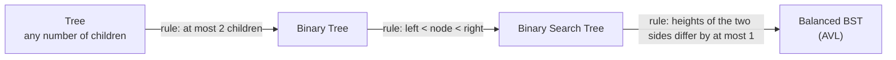

| Structure | The one new rule | What it buys you |
|---|---|---|
| Tree | Nodes connected without cycles, one root | Models hierarchies (folders, org charts) |
| Binary Tree | Every node has **at most 2** children | Simple, uniform node (`left`, `right`) |
| BST | Left subtree < node < right subtree | Fast search by going left or right |
| AVL | Balance factor of every node is -1, 0 or +1 | Search stays fast **in the worst case** |

---

## 2. Tree

### 2.1 Idea

A **tree** is a hierarchical structure made of **nodes** joined by **edges**. One node is the **root**, and every other node has exactly one parent. Trees appear everywhere: the folders on your disk, a company org chart, the HTML of a web page, and the call tree of a recursive function.

### 2.2 Terminology

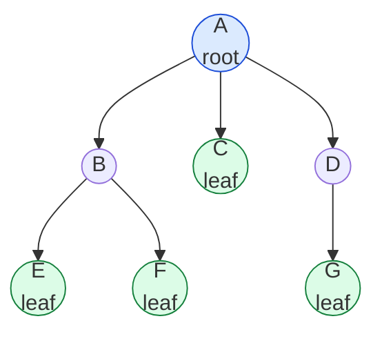

| Term | Meaning | In the diagram |
|---|---|---|
| Root | The top node, with no parent | A |
| Parent / Child | A node directly above / below another | B is the parent of E and F |
| Siblings | Nodes with the same parent | B, C, D |
| Leaf | A node with no children | C, E, F, G |
| Internal node | A node with at least one child | A, B, D |
| Edge | The link between a parent and a child | A to B |
| Subtree | A node together with all its descendants | B, E, F |
| Degree | Number of children of a node | degree(A) = 3, degree(D) = 1 |
| Depth | Number of edges from the root down to the node | depth(E) = 2 |
| Level | Depth counted from 0 (root is level 0) | E, F, G are on level 2 |
| Height | Number of **levels** in the tree (this guide counts an empty tree as 0 and one node as 1) | 3 |

> Some books count height in **edges** instead of levels, which gives 2 for this tree. Both are fine; just stay consistent. All code in this guide counts levels, so a single node has height 1.

### 2.3 Properties

- A tree with `n` nodes has exactly **`n - 1` edges**.
- There is exactly **one path** between any two nodes, so there are **no cycles**.
- Every node except the root has **exactly one parent**.

### 2.4 How to store it

Since a node can have any number of children, each node keeps a **list of children**:

```cpp
struct Node {
    int data;
    vector<Node*> children;
};
```

### 2.5 Traversals

| Traversal | Order | Uses |
|---|---|---|
| Preorder (DFS) | node, then each child | Copying a tree, printing a folder listing |
| Postorder (DFS) | each child, then node | Deleting a tree, computing folder sizes |
| Level order (BFS) | level by level, with a **queue** | Shortest distance from the root, printing by level |

For the tree above: preorder `A B E F C D G`, postorder `E F B C G D A`, level order `A | B C D | E F G`.

### 2.6 Steps to implement

1. Define a private nested `Node` struct with `data` and a `vector<Node*> children`.
2. Keep a private `root` pointer, starting at `nullptr`.
3. Write `findHelper(node, value)`: a depth-first search that returns the node holding `value`.
4. Write `addChild(parentValue, value)`: find the parent, then `push_back` a new node into its `children`.
5. Write the recursive traversals `preorderHelper` and `postorderHelper`, looping over `children`.
6. Write `levelOrder()` with a `std::queue`: pop a node, print it, push all its children.
7. Write `heightHelper` (1 + tallest child) and `countHelper` (1 + sum over children).
8. Write a destructor that deletes the children first, then the node (postorder).

### 2.7 Code (`general_tree.cpp`)

```cpp
#include <iostream>
#include <vector>
#include <queue>
using namespace std;

class GeneralTree {
private:
    struct Node {
        int data;
        vector<Node*> children;   // any number of children
        Node(int value) : data(value) {}
    };

    Node* root;

    // find the node holding 'value' (depth-first search)
    Node* findHelper(Node* node, int value) {
        if (node == nullptr) return nullptr;
        if (node->data == value) return node;
        for (Node* child : node->children) {
            Node* found = findHelper(child, value);
            if (found != nullptr) return found;
        }
        return nullptr;
    }

    void preorderHelper(Node* node) {
        if (node == nullptr) return;
        cout << node->data << " ";            // visit node first
        for (Node* child : node->children)    // then every child, left to right
            preorderHelper(child);
    }

    void postorderHelper(Node* node) {
        if (node == nullptr) return;
        for (Node* child : node->children)    // every child first
            postorderHelper(child);
        cout << node->data << " ";            // then the node
    }

    int heightHelper(Node* node) {
        if (node == nullptr) return 0;
        int maxChild = 0;
        for (Node* child : node->children)
            maxChild = max(maxChild, heightHelper(child));
        return 1 + maxChild;                  // height counted in levels
    }

    int countHelper(Node* node) {
        if (node == nullptr) return 0;
        int count = 1;
        for (Node* child : node->children)
            count += countHelper(child);
        return count;
    }

    void destroyHelper(Node* node) {
        if (node == nullptr) return;
        for (Node* child : node->children)
            destroyHelper(child);
        delete node;
    }

public:
    GeneralTree() : root(nullptr) {}
    ~GeneralTree() { destroyHelper(root); }

    void setRoot(int value) {
        destroyHelper(root);
        root = new Node(value);
    }

    // add 'value' as a new child of the node holding 'parentValue'
    bool addChild(int parentValue, int value) {
        Node* parent = findHelper(root, parentValue);
        if (parent == nullptr) return false;   // parent not found
        parent->children.push_back(new Node(value));
        return true;
    }

    void preorder()  { preorderHelper(root);  cout << endl; }
    void postorder() { postorderHelper(root); cout << endl; }

    // level by level, using a queue (Breadth-First Search)
    void levelOrder() {
        if (root == nullptr) return;
        queue<Node*> q;
        q.push(root);
        while (!q.empty()) {
            int levelSize = q.size();
            for (int i = 0; i < levelSize; i++) {
                Node* current = q.front();
                q.pop();
                cout << current->data << " ";
                for (Node* child : current->children)
                    q.push(child);
            }
            cout << "| ";                      // marks the end of a level
        }
        cout << endl;
    }

    int height() { return heightHelper(root); }
    int size()   { return countHelper(root); }
};

int main() {
    /*
               1
           /   |   \
          2    3    4
         / \        |
        5   6       7
    */
    GeneralTree tree;
    tree.setRoot(1);
    tree.addChild(1, 2);
    tree.addChild(1, 3);
    tree.addChild(1, 4);
    tree.addChild(2, 5);
    tree.addChild(2, 6);
    tree.addChild(4, 7);

    cout << "Preorder   : "; tree.preorder();    // 1 2 5 6 3 4 7
    cout << "Postorder  : "; tree.postorder();   // 5 6 2 3 7 4 1
    cout << "Level order: "; tree.levelOrder();  // 1 | 2 3 4 | 5 6 7 |
    cout << "Height     : " << tree.height() << endl;  // 3
    cout << "Nodes      : " << tree.size() << endl;    // 7
    return 0;
}
```

**Output**

```text
Preorder   : 1 2 5 6 3 4 7
Postorder  : 5 6 2 3 7 4 1
Level order: 1 | 2 3 4 | 5 6 7 |
Height     : 3
Nodes      : 7
```

---

## 3. Binary Tree

### 3.1 Idea

A **binary tree** is a tree where every node has **at most two** children, called `left` and `right`. Because there are always exactly two child slots, every node has the same simple shape:

```cpp
struct Node {
    int data;
    Node* left;
    Node* right;
};
```

### 3.2 Types of binary trees

#### Full binary tree

Every node has **0 or 2** children, never exactly 1.

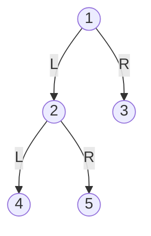

#### Complete binary tree

Every level is full except possibly the last, and the last level is filled **from the left**. Heaps use this shape.

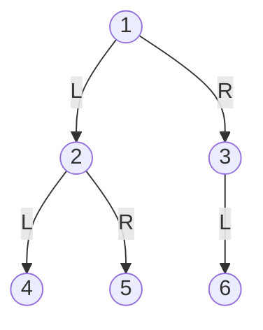

#### Perfect binary tree

**All** levels are completely full, and all leaves are on the same level.

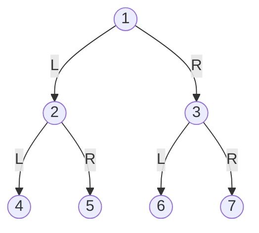

#### Degenerate (skewed) binary tree

Every node has **one** child, so the tree is really a list.


> In these diagrams the edge label **L** or **R** says which side the child is on. Always read the label, since a diagram tool may not place a lone child on the correct side.

A skewed tree behaves like a **linked list**. Remember it: it is the reason balanced trees exist.

### 3.3 Useful numbers

| Fact | Formula | Example |
|---|---|---|
| Most nodes on level `i` (root is level 0) | `2^i` | level 3 holds at most 8 |
| Most nodes in a tree of height `h` | `2^h - 1` | height 3 holds at most 7 |
| Least height for `n` nodes | `ceil(log2(n + 1))` | 7 nodes need height 3 at least |
| Leaves of a full binary tree with `k` internal nodes | `k + 1` | 3 internal nodes give 4 leaves |

### 3.4 Traversals


| Traversal | Rule | Result | Implemented with |
|---|---|---|---|
| Preorder | **Root**, Left, Right | `1 2 4 5 3 6` | recursion, or a stack |
| Inorder | Left, **Root**, Right | `4 2 5 1 6 3` | recursion, or a stack |
| Postorder | Left, Right, **Root** | `4 5 2 6 3 1` | recursion, or two stacks |
| Level order | top to bottom, left to right | `1 2 3 4 5 6` | a **queue** |

> **Memory trick:** the name tells you where the **root** goes. **Pre** = root first, **In** = root in the middle, **Post** = root last. Left is always visited before right.

### 3.5 Steps to implement

1. Define a private nested `Node` with `data`, `left`, `right`, and a constructor that sets both children to `nullptr`.
2. Keep a private `root` pointer.
3. Write `insert(value)` in **level order** using a queue: walk the tree top to bottom, left to right, and put the new node in the first empty `left` or `right` slot. This keeps the tree complete.
4. Write the three recursive traversals as private helpers, each with a public wrapper that passes `root`.
5. Write `levelOrder()` with a queue.
6. Write `inorderIterative()` with a stack: go left as far as possible pushing nodes, pop and print, then move right.
7. Write `height`, `size` and `leaves` recursively.
8. Write a destructor that deletes in postorder (children before parent).

### 3.6 Code (`binary_tree.cpp`)

```cpp
#include <iostream>
#include <queue>
#include <stack>
using namespace std;

class BinaryTree {
private:
    struct Node {
        int data;
        Node *left, *right;
        Node(int value) : data(value), left(nullptr), right(nullptr) {}
    };

    Node* root;

    void preorderHelper(Node* node) {        // Root -> Left -> Right
        if (node == nullptr) return;
        cout << node->data << " ";
        preorderHelper(node->left);
        preorderHelper(node->right);
    }

    void inorderHelper(Node* node) {         // Left -> Root -> Right
        if (node == nullptr) return;
        inorderHelper(node->left);
        cout << node->data << " ";
        inorderHelper(node->right);
    }

    void postorderHelper(Node* node) {       // Left -> Right -> Root
        if (node == nullptr) return;
        postorderHelper(node->left);
        postorderHelper(node->right);
        cout << node->data << " ";
    }

    int heightHelper(Node* node) {
        if (node == nullptr) return 0;
        return 1 + max(heightHelper(node->left), heightHelper(node->right));
    }

    int countHelper(Node* node) {
        if (node == nullptr) return 0;
        return 1 + countHelper(node->left) + countHelper(node->right);
    }

    int leavesHelper(Node* node) {
        if (node == nullptr) return 0;
        if (node->left == nullptr && node->right == nullptr) return 1;
        return leavesHelper(node->left) + leavesHelper(node->right);
    }

    void destroyHelper(Node* node) {
        if (node == nullptr) return;
        destroyHelper(node->left);
        destroyHelper(node->right);
        delete node;
    }

public:
    BinaryTree() : root(nullptr) {}
    ~BinaryTree() { destroyHelper(root); }

    // Insert in level order: fill the first empty spot from top to bottom,
    // left to right. This keeps the tree COMPLETE.
    void insert(int value) {
        Node* newNode = new Node(value);
        if (root == nullptr) { root = newNode; return; }

        queue<Node*> q;
        q.push(root);
        while (!q.empty()) {
            Node* current = q.front();
            q.pop();

            if (current->left == nullptr) { current->left = newNode; return; }
            q.push(current->left);

            if (current->right == nullptr) { current->right = newNode; return; }
            q.push(current->right);
        }
    }

    void preorder()  { preorderHelper(root);  cout << endl; }
    void inorder()   { inorderHelper(root);   cout << endl; }
    void postorder() { postorderHelper(root); cout << endl; }

    // Breadth-First traversal with a queue
    void levelOrder() {
        if (root == nullptr) return;
        queue<Node*> q;
        q.push(root);
        while (!q.empty()) {
            Node* current = q.front();
            q.pop();
            cout << current->data << " ";
            if (current->left)  q.push(current->left);
            if (current->right) q.push(current->right);
        }
        cout << endl;
    }

    // Inorder WITHOUT recursion, using a stack
    void inorderIterative() {
        stack<Node*> stk;
        Node* current = root;
        while (current != nullptr || !stk.empty()) {
            while (current != nullptr) {      // go as far left as possible
                stk.push(current);
                current = current->left;
            }
            current = stk.top();              // visit
            stk.pop();
            cout << current->data << " ";
            current = current->right;         // then go right
        }
        cout << endl;
    }

    int height() { return heightHelper(root); }
    int size()   { return countHelper(root); }
    int leaves() { return leavesHelper(root); }
};

int main() {
    /*
               1
             /   \
            2     3
           / \   /
          4   5 6
    */
    BinaryTree tree;
    for (int value : {1, 2, 3, 4, 5, 6})
        tree.insert(value);

    cout << "Preorder         : "; tree.preorder();          // 1 2 4 5 3 6
    cout << "Inorder          : "; tree.inorder();           // 4 2 5 1 6 3
    cout << "Postorder        : "; tree.postorder();         // 4 5 2 6 3 1
    cout << "Level order      : "; tree.levelOrder();        // 1 2 3 4 5 6
    cout << "Inorder (stack)  : "; tree.inorderIterative();  // 4 2 5 1 6 3
    cout << "Height           : " << tree.height() << endl;  // 3
    cout << "Nodes            : " << tree.size() << endl;    // 6
    cout << "Leaves           : " << tree.leaves() << endl;  // 3
    return 0;
}
```

**Output**

```text
Preorder         : 1 2 4 5 3 6
Inorder          : 4 2 5 1 6 3
Postorder        : 4 5 2 6 3 1
Level order      : 1 2 3 4 5 6
Inorder (stack)  : 4 2 5 1 6 3
Height           : 3
Nodes            : 6
Leaves           : 3
```

---

## 4. Binary Search Tree (BST)

### 4.1 Idea

A **BST** is a binary tree with one extra rule, true at **every** node:

> All values in the **left** subtree are **smaller** than the node, and all values in the **right** subtree are **greater**.

Two consequences follow:

- **Search** only needs one path from the root down: at each node, go left if the value is smaller and right if it is bigger.
- **Inorder traversal prints the values in sorted order.** This is the quickest way to check a BST.

### 4.2 Searching

Searching for **60**: compare with 50 and go right, compare with 70 and go left, found. Only 3 nodes are visited out of 7.

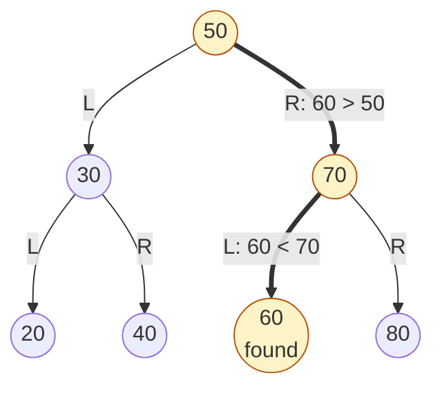

### 4.3 Inserting

A new value always becomes a new **leaf**. Search for it as if it were there, and put it where the search falls off the tree.

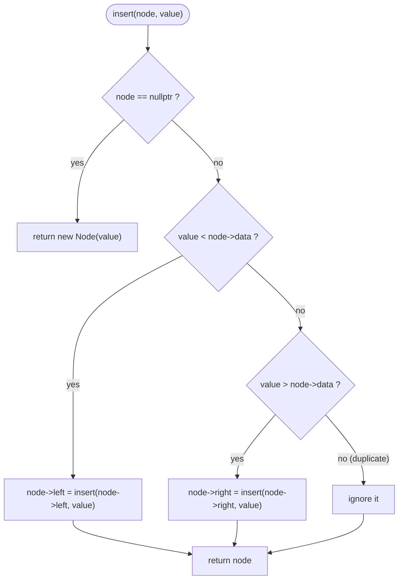

### 4.4 Deleting: the three cases

| Case | Node to delete has | What to do |
|---|---|---|
| 1 | no children (a leaf) | Remove it; the parent's pointer becomes `nullptr` |
| 2 | one child | Replace the node with its only child |
| 3 | two children | Copy the **inorder successor** (smallest value in the right subtree) into the node, then delete the successor from the right subtree |

Case 3, deleting **50**. Its inorder successor is **60**, the leftmost node of the right subtree.

**Before:** delete 50 (red). Its successor is 60 (green).

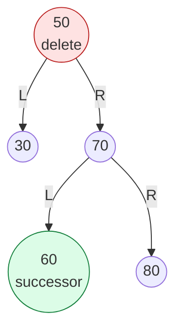

**After:** 60 is copied into the root, and the old 60 is removed from the right subtree.

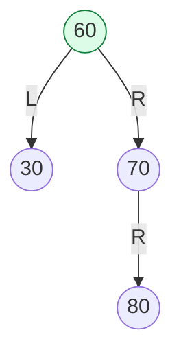

> The successor never has a left child (otherwise that child would be smaller and would be the successor). So deleting it is always case 1 or case 2.

### 4.5 Building a BST from its preorder traversal (with a stack)

Given a preorder sequence, the tree can be rebuilt in **O(n)** with a stack. The stack holds the nodes that could still be the **parent** of the next value.

- The first value is always the **root**: create it and push it.
- For each next value:
  - **Pop** every node on the stack that is **smaller** than the value. The **last popped** node is the parent, and the value becomes its **right** child.
  - If nothing was popped, the value is smaller than the top, so it becomes the top's **left** child.
  - **Push** the new node.

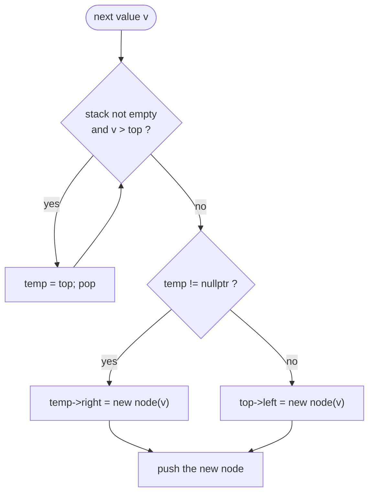

Trace for `pre = {50, 30, 40, 35, 70}`:

| Value | Popped | Placed as | Stack after (bottom to top) |
|---|---|---|---|
| 50 | nothing | root | 50 |
| 30 | nothing | left of 50 | 50, 30 |
| 40 | 30 | right of 30 | 50, 40 |
| 35 | nothing | left of 40 | 50, 40, 35 |
| 70 | 35, 40, 50 | right of 50 | 70 |

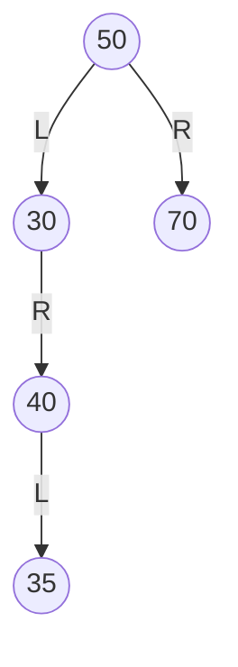

### 4.6 The problem with a plain BST

Insert already sorted values `1, 2, 3, 4, 5, 6, 7` and every node goes to the right:


The height is **7** instead of 3, and search becomes **O(n)**, no better than a linked list. Balanced trees (section 5) fix this.

### 4.7 Steps to implement

1. Define a private nested `Node` with `data`, `left`, `right`.
2. Write a recursive `insertHelper(node, value)` following the flowchart in 4.3, and a public `insert(value)` that does `root = insertHelper(root, value)`.
3. Write `search(value)` with a loop: compare, then move to `left` or `right`.
4. Write `findMin` (go left until you can't) and `maxValue` (go right until you can't).
5. Write `removeHelper(node, value)`: search for the node, then handle the three cases from 4.4. Public `remove(value)` does `root = removeHelper(root, value)`.
6. Write `buildFromPreorder(pre, n)` using `std::stack<Node*>`, following 4.5. Loop `i` from `1` to `n - 1`, so `i < n`.
7. Write `isValidHelper(node, min, max)`: every node must lie strictly between the bounds passed down from its ancestors. Checking only a node against its direct children is **not enough**.
8. Write `inorder`, `preorder`, `height` and the destructor.

### 4.8 Code (`bst.cpp`)

```cpp
#include <iostream>
#include <stack>
#include <climits>
using namespace std;

class BST {
private:
    struct Node {
        int data;
        Node *left, *right;
        Node(int value) : data(value), left(nullptr), right(nullptr) {}
    };

    Node* root;

    Node* insertHelper(Node* node, int value) {
        if (node == nullptr) return new Node(value);     // empty spot found
        if (value < node->data)
            node->left = insertHelper(node->left, value);
        else if (value > node->data)
            node->right = insertHelper(node->right, value);
        // equal value: duplicates are ignored
        return node;
    }

    Node* findMin(Node* node) {                // leftmost node
        while (node != nullptr && node->left != nullptr)
            node = node->left;
        return node;
    }

    Node* removeHelper(Node* node, int value) {
        if (node == nullptr) return nullptr;             // value not in tree

        if (value < node->data) {
            node->left = removeHelper(node->left, value);
        } else if (value > node->data) {
            node->right = removeHelper(node->right, value);
        } else {
            // Case 1 & 2: zero or one child -> replace node by its child
            if (node->left == nullptr) {
                Node* child = node->right;
                delete node;
                return child;
            }
            if (node->right == nullptr) {
                Node* child = node->left;
                delete node;
                return child;
            }
            // Case 3: two children -> copy the inorder successor
            // (smallest value in the right subtree), then delete it there
            Node* successor = findMin(node->right);
            node->data = successor->data;
            node->right = removeHelper(node->right, successor->data);
        }
        return node;
    }

    bool isValidHelper(Node* node, long minValue, long maxValue) {
        if (node == nullptr) return true;
        if (node->data <= minValue || node->data >= maxValue) return false;
        return isValidHelper(node->left, minValue, node->data) &&
               isValidHelper(node->right, node->data, maxValue);
    }

    void inorderHelper(Node* node) {
        if (node == nullptr) return;
        inorderHelper(node->left);
        cout << node->data << " ";
        inorderHelper(node->right);
    }

    void preorderHelper(Node* node) {
        if (node == nullptr) return;
        cout << node->data << " ";
        preorderHelper(node->left);
        preorderHelper(node->right);
    }

    int heightHelper(Node* node) {
        if (node == nullptr) return 0;
        return 1 + max(heightHelper(node->left), heightHelper(node->right));
    }

    void destroyHelper(Node* node) {
        if (node == nullptr) return;
        destroyHelper(node->left);
        destroyHelper(node->right);
        delete node;
    }

public:
    BST() : root(nullptr) {}
    ~BST() { destroyHelper(root); }

    void insert(int value) { root = insertHelper(root, value); }
    void remove(int value) { root = removeHelper(root, value); }

    // Search without recursion: go left or right at each node
    bool search(int value) {
        Node* current = root;
        while (current != nullptr) {
            if (value == current->data) return true;
            current = (value < current->data) ? current->left : current->right;
        }
        return false;
    }

    int minValue() { Node* n = findMin(root); return n ? n->data : INT_MIN; }

    int maxValue() {
        Node* current = root;
        if (current == nullptr) return INT_MAX;
        while (current->right != nullptr) current = current->right;
        return current->data;
    }

    // Rebuild a BST from its preorder traversal in O(n), using a stack
    void buildFromPreorder(int pre[], int n) {
        destroyHelper(root);
        root = nullptr;
        if (n == 0) return;

        stack<Node*> stk;
        root = new Node(pre[0]);                 // first value is always the root
        stk.push(root);

        for (int i = 1; i < n; i++) {
            Node* temp = nullptr;

            // pop every node smaller than the new value;
            // the LAST one popped is the parent
            while (!stk.empty() && pre[i] > stk.top()->data) {
                temp = stk.top();
                stk.pop();
            }

            if (temp != nullptr) {               // new value is a RIGHT child
                temp->right = new Node(pre[i]);
                stk.push(temp->right);
            } else {                             // new value is a LEFT child of top
                stk.top()->left = new Node(pre[i]);
                stk.push(stk.top()->left);
            }
        }
    }

    bool isValid() { return isValidHelper(root, LONG_MIN, LONG_MAX); }
    int height()   { return heightHelper(root); }
    void inorder()  { inorderHelper(root);  cout << endl; }
    void preorder() { preorderHelper(root); cout << endl; }
};

int main() {
    /*
               50
             /    \
           30      70
          /  \    /  \
        20   40  60   80
    */
    BST tree;
    for (int value : {50, 30, 70, 20, 40, 60, 80})
        tree.insert(value);

    cout << "Inorder (sorted) : "; tree.inorder();       // 20 30 40 50 60 70 80
    cout << "Search 60        : " << (tree.search(60) ? "found" : "not found") << endl;
    cout << "Search 65        : " << (tree.search(65) ? "found" : "not found") << endl;
    cout << "Min / Max        : " << tree.minValue() << " / " << tree.maxValue() << endl;

    tree.remove(20);   // case 1: leaf
    cout << "Remove 20 (leaf) : "; tree.inorder();       // 30 40 50 60 70 80
    tree.remove(30);   // case 2: one child
    cout << "Remove 30 (1 ch) : "; tree.inorder();       // 40 50 60 70 80
    tree.remove(50);   // case 3: two children (root)
    cout << "Remove 50 (2 ch) : "; tree.inorder();       // 40 60 70 80
    cout << "Preorder now     : "; tree.preorder();      // 60 40 70 80
    cout << "Valid BST?       : " << (tree.isValid() ? "yes" : "no") << endl;

    // Build from preorder with a stack
    int pre[] = {50, 30, 40, 35, 70};
    BST built;
    built.buildFromPreorder(pre, 5);
    cout << "Built, inorder   : "; built.inorder();      // 30 35 40 50 70
    cout << "Built, preorder  : "; built.preorder();     // 50 30 40 35 70

    // Why balancing matters: sorted input makes a "linked list"
    BST skewed;
    for (int value = 1; value <= 7; value++) skewed.insert(value);
    cout << "Skewed height    : " << skewed.height() << " (7 nodes)" << endl;  // 7
    return 0;
}
```

**Output**

```text
Inorder (sorted) : 20 30 40 50 60 70 80
Search 60        : found
Search 65        : not found
Min / Max        : 20 / 80
Remove 20 (leaf) : 30 40 50 60 70 80
Remove 30 (1 ch) : 40 50 60 70 80
Remove 50 (2 ch) : 40 60 70 80
Preorder now     : 60 40 70 80
Valid BST?       : yes
Built, inorder   : 30 35 40 50 70
Built, preorder  : 50 30 40 35 70
Skewed height    : 7 (7 nodes)
```

---

## 5. Balanced Trees and AVL

### 5.1 Idea

A tree is **balanced** when its height stays close to the minimum possible, about `log2(n)`. Then search, insert and delete are **O(log n) even in the worst case**.

| Balanced tree | Rule | Typical use |
|---|---|---|
| **AVL tree** | For every node, the heights of the left and right subtrees differ by at most 1 | Read-heavy data: stricter balance gives faster search |
| Red-Black tree | Color rules keep the longest path at most twice the shortest | Common inside ordered maps and sets in standard libraries |
| B-Tree | Many keys per node, all leaves on the same level | Databases and file systems |

This guide implements the **AVL tree**, which is a BST that repairs itself after every insert and delete.

### 5.2 Balance factor

```
balance factor (BF) = height(left subtree) - height(right subtree)
```

- BF of **-1, 0 or +1**: the node is balanced.
- BF of **+2**: the left side is too tall.
- BF of **-2**: the right side is too tall.

Each node stores its own `height`, so the balance factor is computed in O(1).

**Balanced:** every balance factor is between -1 and +1.

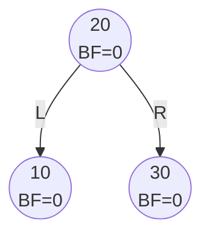

**Unbalanced:** node 10 has BF = -2 (left height 0, right height 2).

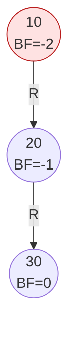

### 5.3 Rotations

A rotation changes the shape of a subtree **without breaking the BST order**. There are two basic rotations, and they are mirror images.

**Right rotation** at `node` (used when the left side is too tall):

**Before:**

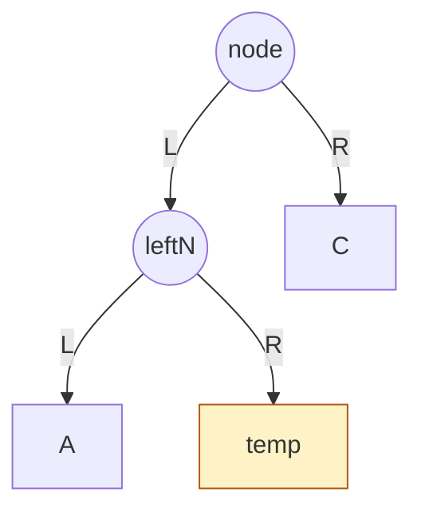

**After `rightRotate(node)`:**

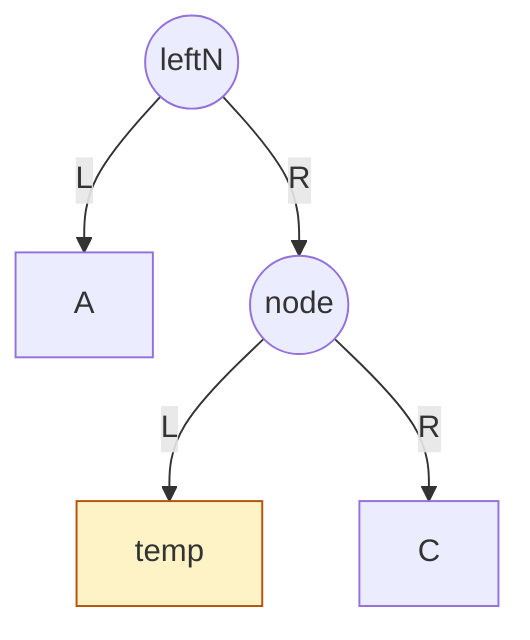

`leftN` moves up, `node` moves down to its right, and the subtree `temp` changes parent from `leftN` to `node`. The order is still `A < leftN < temp < node < C`.

**Left rotation** is the mirror: `rightN` moves up, `node` moves down to its left, and `rightN`'s old left subtree becomes `node`'s right subtree.

> **After a rotation, update the height of the node that moved down first**, then the node that moved up, because the upper node's height depends on the lower one.

### 5.4 The four imbalance cases

The case is named after the path from the unbalanced node down to where the new value went.

| Case | Unbalanced node BF | Child BF | Fix |
|---|---|---|---|
| **LL** | +2 | left child is 0 or +1 | `rightRotate(node)` |
| **RR** | -2 | right child is 0 or -1 | `leftRotate(node)` |
| **LR** | +2 | left child is -1 | `leftRotate(node->left)`, then `rightRotate(node)` |
| **RL** | -2 | right child is +1 | `rightRotate(node->right)`, then `leftRotate(node)` |

Each case below starts from three inserts. The red node is the unbalanced one.

**LL** (insert 30, 20, 10). Fix: `rightRotate(30)`.

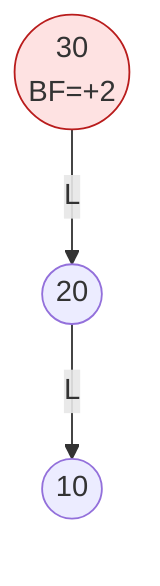

**RR** (insert 10, 20, 30). Fix: `leftRotate(10)`.

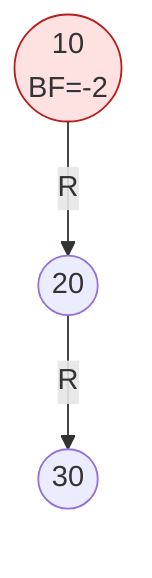

**LR** (insert 30, 10, 20). Fix: `leftRotate(10)`, then `rightRotate(30)`.

```mermaid
flowchart TD
    lr30(("30<br/>BF=+2")) -->|L| lr10((10))
    lr10 -->|R| lr20((20))
    classDef bad fill:#fee2e2,stroke:#b91c1c
    class lr30 bad
```

**RL** (insert 10, 30, 20). Fix: `rightRotate(30)`, then `leftRotate(10)`.

```mermaid
flowchart TD
    rl10(("10<br/>BF=-2")) -->|R| rl30((30))
    rl30 -->|L| rl20((20))
    classDef bad fill:#fee2e2,stroke:#b91c1c
    class rl10 bad
```

**All four cases end up as the same balanced tree:**

```mermaid
flowchart TD
    x20((20)) -->|L| x10((10))
    x20 -->|R| x30((30))
```

LR and RL are "zig-zag" shapes. The first rotation straightens the zig-zag into a straight line (LL or RR), and the second rotation fixes that line.

### 5.5 Which rotation? (the decision the code makes)

This runs on every node **on the way back up** the recursion, after the normal BST insert or delete.

```mermaid
flowchart TD
    S(["after inserting or deleting below node"]) --> H["update node->height"]
    H --> B["bf = getBalance(node)"]
    B --> Q1{"bf > 1 ?<br/>(left too tall)"}
    Q1 -->|yes| Q2{"getBalance(node->left) >= 0 ?"}
    Q2 -->|yes| LL["LL: rightRotate(node)"]
    Q2 -->|no| LR["LR: leftRotate(node->left)<br/>then rightRotate(node)"]
    Q1 -->|no| Q3{"bf < -1 ?<br/>(right too tall)"}
    Q3 -->|yes| Q4{"getBalance(node->right) <= 0 ?"}
    Q4 -->|yes| RR["RR: leftRotate(node)"]
    Q4 -->|no| RL["RL: rightRotate(node->right)<br/>then leftRotate(node)"]
    Q3 -->|no| OK["balanced: return node"]
```

> The checks use `>= 0` and `<= 0` rather than `== 1` and `== -1`. After an **insert** the child's balance factor is never 0 here, but after a **delete** it can be, and then a single rotation is the correct fix.

### 5.6 Walkthrough: inserting 10, 20, 30, 25, 28, 27, 5

| Step | Insert | Unbalanced node | Case | Tree after (preorder) |
|---|---|---|---|---|
| 1 | 10 | none | | 10 |
| 2 | 20 | none | | 10 20 |
| 3 | 30 | 10 (BF = -2) | RR | 20 10 30 |
| 4 | 25 | none | | 20 10 30 25 |
| 5 | 28 | 30 (BF = +2) | LR | 20 10 28 25 30 |
| 6 | 27 | 20 (BF = -2) | RL | 25 20 10 28 27 30 |
| 7 | 5 | 20 (BF = +2) | LL | 25 10 5 20 28 27 30 |

In step 5, node 20 also has BF = -2 at first, but the recursion reaches **30 first** (it is the deepest unbalanced node). Fixing 30 lowers that subtree, which repairs 20 as well. That is why only the **first unbalanced ancestor** ever needs fixing after an insert.

Final tree, all four cases used along the way:

```mermaid
flowchart TD
    f25((25)) -->|L| f10((10))
    f25 -->|R| f28((28))
    f10 -->|L| f5((5))
    f10 -->|R| f20((20))
    f28 -->|L| f27((27))
    f28 -->|R| f30((30))
```

### 5.7 Steps to implement

1. Define a private nested `Node` with `data`, `left`, `right` and **`height`**, where a new node has height 1.
2. Write `height(node)`, which returns 0 for `nullptr`. Every other function depends on this null check.
3. Write `updateHeight(node)`: `1 + max(height(left), height(right))`.
4. Write `getBalance(node)`: `height(left) - height(right)`, and 0 for `nullptr`.
5. Write `rightRotate(node)`:
   - Save `leftN = node->left` and `temp = leftN->right`.
   - Re-link: `leftN->right = node`, then `node->left = temp`.
   - Update the height of `node`, then of `leftN`.
   - Return `leftN`, the new root of this subtree.
6. Write `leftRotate(node)` as the mirror of step 5.
7. Write `rebalance(node)`, following the flowchart in 5.5. Both insert and delete use it.
8. Write `insertHelper(node, value)`: a normal BST insert, then `return rebalance(node)`.
9. Write `removeHelper(node, value)`: a normal BST delete (the three cases from 4.4), then `return rebalance(node)`.
10. Add the public wrappers `insert`, `remove` and `search`, plus `inorder`, `preorder`, `height`, `isBalanced`, and the destructor.
11. Test each rotation with the four 3-value sequences from 5.4 before trying bigger inputs.

### 5.8 Code (`avl.cpp`)

Pass `true` to the constructor, as in `AVLTree tree(true);`, to print every rotation as it happens.

```cpp
#include <iostream>
#include <string>
using namespace std;

class AVLTree {
private:
    struct Node {
        int data;
        Node *left, *right;
        int height;                     // height of the subtree rooted here
        Node(int value) : data(value), left(nullptr), right(nullptr), height(1) {}
    };

    Node* root;
    bool trace;                         // print each rotation when true

    int height(Node* node) { return node == nullptr ? 0 : node->height; }

    void updateHeight(Node* node) {
        node->height = 1 + max(height(node->left), height(node->right));
    }

    int getBalance(Node* node) {
        return node == nullptr ? 0 : height(node->left) - height(node->right);
    }

    /*
           node                leftN
           /    \              /    \
        leftN    C    ==>     A     node
        /   \                       /   \
       A    temp                 temp    C
    */
    Node* rightRotate(Node* node) {
        Node* leftN = node->left;
        Node* temp = leftN->right;

        leftN->right = node;
        node->left = temp;

        updateHeight(node);             // node first: it is now lower
        updateHeight(leftN);
        return leftN;
    }

    /*
        node                       rightN
        /   \                      /    \
       A   rightN       ==>     node     C
           /    \               /   \
        temp     C             A    temp
    */
    Node* leftRotate(Node* node) {
        Node* rightN = node->right;
        Node* temp = rightN->left;

        rightN->left = node;
        node->right = temp;

        updateHeight(node);
        updateHeight(rightN);
        return rightN;
    }

    void log(const string& kind, Node* node) {
        if (trace) cout << "  [" << kind << " rotation at " << node->data << "]" << endl;
    }

    // Shared by insert and remove: fix 'node' if it became unbalanced
    Node* rebalance(Node* node) {
        updateHeight(node);
        int balance = getBalance(node);

        if (balance > 1) {                              // left side too tall
            if (getBalance(node->left) >= 0) {          // LL
                log("LL", node);
                return rightRotate(node);
            }
            log("LR", node);                            // LR
            node->left = leftRotate(node->left);
            return rightRotate(node);
        }
        if (balance < -1) {                             // right side too tall
            if (getBalance(node->right) <= 0) {         // RR
                log("RR", node);
                return leftRotate(node);
            }
            log("RL", node);                            // RL
            node->right = rightRotate(node->right);
            return leftRotate(node);
        }
        return node;                                    // already balanced
    }

    Node* insertHelper(Node* node, int value) {
        // 1) normal BST insert
        if (node == nullptr) return new Node(value);
        if (value < node->data)
            node->left = insertHelper(node->left, value);
        else if (value > node->data)
            node->right = insertHelper(node->right, value);
        else
            return node;                                // no duplicates

        // 2) on the way back up: update height and rebalance
        return rebalance(node);
    }

    Node* findMin(Node* node) {
        while (node->left != nullptr) node = node->left;
        return node;
    }

    Node* removeHelper(Node* node, int value) {
        // 1) normal BST delete
        if (node == nullptr) return nullptr;
        if (value < node->data) {
            node->left = removeHelper(node->left, value);
        } else if (value > node->data) {
            node->right = removeHelper(node->right, value);
        } else {
            if (node->left == nullptr || node->right == nullptr) {
                Node* child = (node->left != nullptr) ? node->left : node->right;
                delete node;
                return child;                           // may be nullptr
            }
            Node* successor = findMin(node->right);
            node->data = successor->data;
            node->right = removeHelper(node->right, successor->data);
        }
        // 2) on the way back up: update height and rebalance
        return rebalance(node);
    }

    void inorderHelper(Node* node) {
        if (node == nullptr) return;
        inorderHelper(node->left);
        cout << node->data << " ";
        inorderHelper(node->right);
    }

    void preorderHelper(Node* node) {
        if (node == nullptr) return;
        cout << node->data << " ";
        preorderHelper(node->left);
        preorderHelper(node->right);
    }

    bool isBalancedHelper(Node* node) {
        if (node == nullptr) return true;
        int balance = getBalance(node);
        return balance >= -1 && balance <= 1 &&
               isBalancedHelper(node->left) && isBalancedHelper(node->right);
    }

    void destroyHelper(Node* node) {
        if (node == nullptr) return;
        destroyHelper(node->left);
        destroyHelper(node->right);
        delete node;
    }

public:
    AVLTree(bool traceRotations = false) : root(nullptr), trace(traceRotations) {}
    ~AVLTree() { destroyHelper(root); }

    void insert(int value) { root = insertHelper(root, value); }
    void remove(int value) { root = removeHelper(root, value); }

    bool search(int value) {
        Node* current = root;
        while (current != nullptr) {
            if (value == current->data) return true;
            current = (value < current->data) ? current->left : current->right;
        }
        return false;
    }

    int height()       { return height(root); }
    bool isBalanced()  { return isBalancedHelper(root); }
    void inorder()     { inorderHelper(root);  cout << endl; }
    void preorder()    { preorderHelper(root); cout << endl; }
};

void runCase(const string& name, int a, int b, int c) {
    cout << name << ": insert " << a << ", " << b << ", " << c << endl;
    AVLTree tree(true);
    tree.insert(a); tree.insert(b); tree.insert(c);
    cout << "  preorder after: "; tree.preorder();
}

int main() {
    // One test for each of the 4 rotation cases
    runCase("RR", 10, 20, 30);
    runCase("LL", 30, 20, 10);
    runCase("LR", 30, 10, 20);
    runCase("RL", 10, 30, 20);
    cout << endl;

    // The example from the lecture notes
    AVLTree tree(true);
    for (int value : {10, 20, 30, 25, 28, 27, 5}) {
        cout << "insert " << value << endl;
        tree.insert(value);
    }
    cout << "Inorder  : "; tree.inorder();     // 5 10 20 25 27 28 30
    cout << "Preorder : "; tree.preorder();    // 25 10 5 20 28 27 30
    cout << "Height   : " << tree.height() << endl;                    // 3
    cout << "Balanced : " << (tree.isBalanced() ? "yes" : "no") << endl;

    cout << "remove 5, then 10" << endl;
    tree.remove(5);
    tree.remove(10);
    cout << "Preorder : "; tree.preorder();
    cout << "Balanced : " << (tree.isBalanced() ? "yes" : "no") << endl;

    // Same sorted input that made the plain BST a "linked list"
    AVLTree sorted;
    for (int value = 1; value <= 7; value++) sorted.insert(value);
    cout << "Sorted 1..7 height: " << sorted.height() << " (plain BST: 7)" << endl;  // 3
    return 0;
}
```

**Output**

```text
RR: insert 10, 20, 30
  [RR rotation at 10]
  preorder after: 20 10 30
LL: insert 30, 20, 10
  [LL rotation at 30]
  preorder after: 20 10 30
LR: insert 30, 10, 20
  [LR rotation at 30]
  preorder after: 20 10 30
RL: insert 10, 30, 20
  [RL rotation at 10]
  preorder after: 20 10 30

insert 10
insert 20
insert 30
  [RR rotation at 10]
insert 25
insert 28
  [LR rotation at 30]
insert 27
  [RL rotation at 20]
insert 5
  [LL rotation at 20]
Inorder  : 5 10 20 25 27 28 30
Preorder : 25 10 5 20 28 27 30
Height   : 3
Balanced : yes
remove 5, then 10
Preorder : 25 20 28 27 30
Balanced : yes
Sorted 1..7 height: 3 (plain BST: 7)
```

The last line shows the difference: the same sorted input that made the plain BST 7 levels tall gives an AVL tree only 3 levels tall.

---

## 6. Complexity summary

`n` is the number of nodes and `h` is the height of the tree.

| Operation | General tree | Binary tree (unordered) | BST, average | BST, worst (skewed) | AVL, worst |
|---|---|---|---|---|---|
| Search | O(n) | O(n) | O(log n) | O(n) | **O(log n)** |
| Insert | O(n) to find the parent | O(n) level order | O(log n) | O(n) | **O(log n)** |
| Delete | O(n) | O(n) | O(log n) | O(n) | **O(log n)** |
| Traversal | O(n) | O(n) | O(n) | O(n) | O(n) |
| Extra space for recursion | O(h) | O(h) | O(log n) | O(n) | O(log n) |
| Extra memory per node | children list | 2 pointers | 2 pointers | 2 pointers | 2 pointers + `height` |

---

## 7. Common mistakes

These all appeared in real handwritten solutions, so check your own code for them.

| Mistake | Wrong | Right |
|---|---|---|
| Using a variable that was never declared | `AVLNode* newNode = ...;` then `new->left = NULL;` | `newNode->left = NULL;` |
| Reading through the wrong pointer in a rotation | `AVLNode* temp = left->right;` | `AVLNode* temp = leftN->right;` |
| Checking the same node twice in the LR case, so it can never be true | `getBalance(node) == 2 && getBalance(node) == -1` | `getBalance(node) == 2 && getBalance(node->left) == -1` |
| Loop stops one element early, so the last value is never inserted | `for (i = 1; i < n - 1; i++)` | `for (i = 1; i < n; i++)` |
| Updating heights in the wrong order after a rotation | upper node first | the node that moved **down** first |
| Forgetting to keep the returned root | `insert(root, 10);` | `root = insert(root, 10);` (the class wrapper does this for you) |
| Validating a BST by comparing a node only with its children | `left < node < right` at each node | pass `min` and `max` bounds down the tree |
| A `//` comment ending in `\` | the next line becomes part of the comment | use `/* */` for ASCII tree drawings |

---

## 8. Compile and run in VS Code

1. Install the **C/C++** extension by Microsoft, and make sure `g++` is installed (`g++ --version` in a terminal).
2. Save each code block as its own file: `general_tree.cpp`, `binary_tree.cpp`, `bst.cpp`, `avl.cpp`.
3. Open the terminal with `` Ctrl+` `` and compile:

   ```bash
   g++ -std=c++17 -Wall general_tree.cpp -o general_tree
   g++ -std=c++17 -Wall binary_tree.cpp  -o binary_tree
   g++ -std=c++17 -Wall bst.cpp          -o bst
   g++ -std=c++17 -Wall avl.cpp          -o avl
   ```

4. Run: `./avl` on Linux or macOS, or `avl.exe` on Windows.
5. Compare what you get with the **Output** blocks in this guide. If they differ, trace your code by hand on the same input.
6. Optional, on Linux or macOS: add `-fsanitize=address` when compiling to catch memory errors such as using a deleted node.

---

## 9. Practice problems

Solve them roughly in this order. Easy problems check the basics, and the harder ones combine several ideas.

| Topic | Easy | Medium | Hard |
|---|---|---|---|
| Binary Tree | [Maximum Depth of Binary Tree](https://leetcode.com/problems/maximum-depth-of-binary-tree/), [Invert Binary Tree](https://leetcode.com/problems/invert-binary-tree/), [Diameter of Binary Tree](https://leetcode.com/problems/diameter-of-binary-tree/) | [Binary Tree Right Side View](https://leetcode.com/problems/binary-tree-right-side-view/), [Lowest Common Ancestor of a Binary Tree](https://leetcode.com/problems/lowest-common-ancestor-of-a-binary-tree/), [Construct Binary Tree from Preorder and Inorder Traversal](https://leetcode.com/problems/construct-binary-tree-from-preorder-and-inorder-traversal/) | [Binary Tree Maximum Path Sum](https://leetcode.com/problems/binary-tree-maximum-path-sum/), [Serialize and Deserialize Binary Tree](https://leetcode.com/problems/serialize-and-deserialize-binary-tree/) |
| BST | [Search in a Binary Search Tree](https://leetcode.com/problems/search-in-a-binary-search-tree/), [Convert Sorted Array to Binary Search Tree](https://leetcode.com/problems/convert-sorted-array-to-binary-search-tree/), [Range Sum of BST](https://leetcode.com/problems/range-sum-of-bst/) | [Validate Binary Search Tree](https://leetcode.com/problems/validate-binary-search-tree/), [Kth Smallest Element in a BST](https://leetcode.com/problems/kth-smallest-element-in-a-bst/), [Delete Node in a BST](https://leetcode.com/problems/delete-node-in-a-bst/), [Construct BST from Preorder Traversal](https://leetcode.com/problems/construct-binary-search-tree-from-preorder-traversal/) | [Maximum Sum BST in Binary Tree](https://leetcode.com/problems/maximum-sum-bst-in-binary-tree/) |
| Balanced | | [Balance a Binary Search Tree](https://leetcode.com/problems/balance-a-binary-search-tree/), [Balanced Binary Tree](https://leetcode.com/problems/balanced-binary-tree/) (Easy on LeetCode, but uses the balance factor idea) | |

Several of these map directly to this guide: **Construct BST from Preorder Traversal** is section 4.5, **Delete Node in a BST** is section 4.4, **Validate Binary Search Tree** is the `isValid` method, and **Balance a Binary Search Tree** leads straight into section 5.
